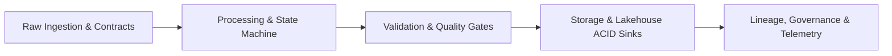

# 🌊 The Real-Time Event Streaming & Ingestion Handbook

**Enterprise Reference Architecture, Production Incident Runbooks & 4-Tier Interview Preparation Matrix**

[](https://github.com/santoshjammi29/streaming-handbook/actions)
[](#)
[](LICENSE)

> Production Apache Kafka, Apache Flink, Debezium CDC, and stream-to-lakehouse exactly-once architectures.  
> Part of the **Modern Data Engineering & Lakehouse Systems Encyclopedia** ecosystem anchored by [**moderndataengineer.uk**](https://moderndataengineer.uk).

[Platform Architecture](#️-platform-architecture) • [Whiteboard Blueprints](#-whiteboard-blueprints) • [Interactive CLI](#-interactive-cli-explorer) • [Architectures](#️-architectural-deep-dives) • [Runbooks](#-production-incident-runbooks) • [Interview Matrix](#-4-tier-interview-preparation-matrix) • [Sister Repositories](#-ecosystem-interlinking--sister-repositories)

---

## 🎯 Overview & Mission

Modern enterprise data systems require rigorous operational governance, predictable failure recovery, deterministic schemas, and observable pipeline execution.

This repository provides **battle-tested production specifications**:
- **4 Deep-Dive Architectural Blueprints**: In-depth engine mechanics, state stores, and Mermaid diagrams.
- **6 Production Incident Disaster Recovery Runbooks**: SEV-1 and SEV-2 playbooks with Emergency Decision Trees.
- **4-Tier Progressive Interview Matrix & 50 Flashcards**: Level 100 to Level 400 questions and active recall deck.
- **52 Whiteboard Blueprints**: Architectural infographics mirrored under `assets/whiteboards/`.
- **Interactive Terminal Shell**: Instant search and study directly from the terminal via `python scripts/interactive_shell.py`.

---

## 🏛️ Platform Architecture



---

## 🖼️ Whiteboard Blueprints

The repository includes **52 publication-grade architectural whiteboard blueprints** mirrored under `assets/whiteboards/` and cataloged in [docs/whiteboard_diagrams/README.md](docs/whiteboard_diagrams/README.md).

---

## 💻 Interactive CLI Explorer

Explore architectures, runbooks, and interview guides directly from your terminal:

```bash
# Browse catalog
python scripts/interactive_shell.py --list
python scripts/interactive_shell.py --runbooks
python scripts/interactive_shell.py --architectures
python scripts/interactive_shell.py --interview
python scripts/interactive_shell.py --ecosystem

# Run self-contained test suite
python scripts/run_tests.py
```

---

## 🏛️ Architectural Deep Dives

Four production-tested architectural specifications located under `architectures/`:

| Spec ID | Document Title | Target Level | Core Architectural Focus |
| :---: | :--- | :---: | :--- |
| **01** | **[Kafka Partition Storage & Consumer Group Protocol](architectures/01_kafka_storage_internals_and_consumer_groups.md)** | `Level 300-400` | Segment files, zero-copy index lookups, offset commit protocols, and rebalance algorithms. |
| **02** | **[Flink Distributed Runtime & Asynchronous Barrier Snapshots](architectures/02_flink_distributed_runtime_and_chandy_lamport.md)** | `Level 300-400` | Chandy-Lamport checkpointing, stream alignment, RocksDB state backends, and WAL sinks. |
| **03** | **[Change Data Capture (CDC) with Debezium & Kafka Connect](architectures/03_cdc_debezium_log_mining_architecture.md)** | `Level 300-400` | Database WAL mining (Postgres WAL, MySQL binlog), snapshotting, and tombstone event propagation. |
| **04** | **[Stream-to-Lakehouse Exactly-Once Ingestion](architectures/04_stream_to_lakehouse_exactly_once_mechanics.md)** | `Level 300-400` | Two-Phase Commit sinks, micro-batch coordination, and Delta/Iceberg atomic transaction logs. |

---

## 🚨 Production Incident Runbooks

Six operational disaster recovery runbooks located under `runbooks/`:

| Runbook ID | Title & Direct Link | Severity | Root Cause & Remediation Focus |
| :---: | :--- | :---: | :--- |
| **01** | **[Consumer Group Rebalance Storm & Lag Surge Triage](runbooks/01_consumer_group_rebalance_storm_triage.md)** | `SEV-1` | Triage max.poll.interval.ms expirations, heartbeats, and stop-the-world partition rebalances. |
| **02** | **[Flink Backpressure & Checkpoint Timeout Triage](runbooks/02_flink_backpressure_and_checkpoint_timeout_triage.md)** | `SEV-1` | Locate bottleneck operators, tune network buffer pools, and resolve unaligned checkpoints. |
| **03** | **[CDC Schema Drift & Database WAL Disk Exhaustion](runbooks/03_cdc_schema_drift_and_wal_exhaustion.md)** | `SEV-1` | Handle replication slot stalls, upstream disk 100% saturation, and schema evolution. |
| **04** | **[Corrupt Event Deserialization & DLQ Routing](runbooks/04_poison_pill_deserialization_dead_letter_queue.md)** | `SEV-2` | Isolate malformed payloads, unparseable JSON/Avro, and route safely to dead-letter topics. |
| **05** | **[Flink RocksDB Off-Heap Native Memory Leak Triage](runbooks/05_rocksdb_offheap_memory_leak_triage.md)** | `SEV-2` | Diagnose block cache over-allocation, write buffer spill, and container OS OOM kills. |
| **06** | **[Kafka Under-Replicated Partitions & Broker Failure Recovery](runbooks/06_kafka_under_replicated_partitions_disaster_recovery.md)** | `SEV-1` | Recover offline replicas, resolve leader election failures, and rebalance partition replicas. |

---

## 🎓 4-Tier Interview Preparation Matrix

Comprehensive technical interview guides and flashcard deck located under `interview/`:

| Tier | Role Target | Core Focus Areas | Direct Link |
| :---: | :--- | :--- | :---: |
| **Tier 1** | **Junior Streaming Engineer** | Kafka topics, partitions, producers, consumer offsets, basic serialization. | [`01_junior.md`](interview/01_junior_streaming_engineer.md) |
| **Tier 2** | **Mid-Level Streaming Engineer** | Consumer lag, Kafka Connect, Avro Schema Registry, Flink tumbling windows. | [`02_mid_level.md`](interview/02_mid_level_streaming_engineer.md) |
| **Tier 3** | **Senior Distributed Systems Engineer** | Chandy-Lamport state snapshots, RocksDB tuning, stream-stream joins, exact-once. | [`03_senior.md`](interview/03_senior_distributed_systems_engineer.md) |
| **Tier 4** | **Staff & Principal Streaming Architect** | Multi-datacenter Kafka replication (MirrorMaker 2), capacity math, edge IoT ingest. | [`04_staff.md`](interview/04_staff_principal_streaming_architect.md) |
| **Deck** | **50 Rapid-Fire Flashcards** | 50 active recall questions and answers for technical mastery. | [`05_flashcards.md`](interview/05_flashcards_deck_50.md) |

---

## 🌐 Ecosystem Interlinking & Sister Repositories

The Modern Data Engineering ecosystem is intentionally partitioned into specialized, tightly coupled reference repositories anchored by **[Modern Data Engineer Platform (`moderndataengineer.uk`)](https://github.com/santoshjammi29/moderndataengineer)**:

| Core Engineering Focus | Flagship Repository | Direct Deep-Link Topics & Implementations in Sister Repositories |
| :--- | :--- | :--- |
| **Apache Spark & PySpark Core** | **[The PySpark Handbook](https://github.com/santoshjammi29/pyspark-handbook)** | • **Delta Lake ACID & Liquid Clustering**: [Databricks Handbook Mod 03 & 04](https://github.com/santoshjammi29/databricks-handbook)<br>• **SQL Windowing Equivalents**: [SQL Handbook Mod 04](https://github.com/santoshjammi29/sql-handbook)<br>• **Azure VNet Injection & Fabric Spark**: [Azure Cheat Sheet](https://github.com/santoshjammi29/azure-cheat-sheet) |
| **Databricks Platform** | **[The Databricks Handbook](https://github.com/santoshjammi29/databricks-handbook)** | • **Core PyArrow UDFs & Higher-Order Functions**: [PySpark Handbook Mod 01 & 02](https://github.com/santoshjammi29/pyspark-handbook)<br>• **Databricks SQL vs ANSI Rosetta Stone**: [SQL Handbook Runbook 05](https://github.com/santoshjammi29/sql-handbook)<br>• **Azure Databricks Landing Zones & Bicep IaC**: [Azure Cheat Sheet](https://github.com/santoshjammi29/azure-cheat-sheet) |
| **Relational & Cloud MPP SQL** | **[The SQL Handbook](https://github.com/santoshjammi29/sql-handbook)** | • **Distributed Data Movement & Skew Salting**: [PySpark Runbook 03](https://github.com/santoshjammi29/pyspark-handbook)<br>• **Serverless SQL Warehouse Spill Tuning**: [Databricks Runbook 05](https://github.com/santoshjammi29/databricks-handbook)<br>• **Synapse & Fabric OneLake Direct Lake SQL**: [Azure Architecture 01](https://github.com/santoshjammi29/azure-cheat-sheet) |
| **Enterprise Cloud & Fabric** | **[Azure Enterprise Handbook](https://github.com/santoshjammi29/azure-cheat-sheet)** | • **Databricks Asset Bundles (DABs) & Lakeflow**: [Databricks Handbook Mod 07](https://github.com/santoshjammi29/databricks-handbook)<br>• **Structured Streaming & RocksDB State**: [PySpark Handbook Mod 06](https://github.com/santoshjammi29/pyspark-handbook)<br>• **Cloud Warehouse Cost Hardening**: [SQL Handbook Runbook 06](https://github.com/santoshjammi29/sql-handbook) |
| **Analytics Engineering & dbt** | **[The dbt Handbook](https://github.com/santoshjammi29/dbt-handbook)** | • **Incremental Merge Optimizations**: [SQL Handbook Mod 06](https://github.com/santoshjammi29/sql-handbook)<br>• **dbt on Databricks & Unity Catalog**: [Databricks Handbook Mod 07](https://github.com/santoshjammi29/databricks-handbook)<br>• **Automated WAP Quality Gates**: [DataOps Handbook](https://github.com/santoshjammi29/dataops-cicd-handbook) |
| **Real-Time Streaming** | **[The Streaming Handbook](https://github.com/santoshjammi29/streaming-handbook)** | • **PySpark Structured Streaming & Watermarks**: [PySpark Handbook Mod 06](https://github.com/santoshjammi29/pyspark-handbook)<br>• **Event Hubs & IoT Real-Time Engine**: [Azure Architecture 04](https://github.com/santoshjammi29/azure-cheat-sheet)<br>• **Debezium CDC to Delta Lake**: [Databricks Handbook Mod 04](https://github.com/santoshjammi29/databricks-handbook) |
| **Data Systems Design** | **[Data System Design Handbook](https://github.com/santoshjammi29/data-system-design-handbook)** | • **MPP Distributed Engine Internals**: [SQL Handbook Architecture 02](https://github.com/santoshjammi29/sql-handbook)<br>• **Unified Memory & Catalyst Engine**: [PySpark Architecture 01 & 02](https://github.com/santoshjammi29/pyspark-handbook)<br>• **Zero-Trust Enterprise Landing Zones**: [Azure Architecture 02](https://github.com/santoshjammi29/azure-cheat-sheet) |
| **DataOps & Platform CI/CD** | **[DataOps & Platform Handbook](https://github.com/santoshjammi29/dataops-cicd-handbook)** | • **Databricks Asset Bundles (DABs) IaC**: [Databricks Handbook Mod 07](https://github.com/santoshjammi29/databricks-handbook)<br>• **Azure Bicep IaC & GitHub Actions OIDC**: [Azure Cheatsheet](https://github.com/santoshjammi29/azure-cheat-sheet)<br>• **dbt Slim CI & State Deferral**: [dbt Handbook](https://github.com/santoshjammi29/dbt-handbook) |
| **Unified Web Platform** | **[Modern Data Engineer Hub](https://github.com/santoshjammi29/moderndataengineer)** | • **Interactive Simulators & 52 Blueprints**: [Live Platform (`moderndataengineer.uk`)](https://moderndataengineer.uk)<br>• **Google-Grade BM25F Search & Virtual DOM**: [Architecture Spec](https://github.com/santoshjammi29/moderndataengineer/blob/main/docs/STANDARDIZED_ARCHITECTURE.md) |


---

## 📜 License

Distributed under the **[MIT License](LICENSE)**. Maintained with ❤️ by [Santosh Jammi](https://github.com/santoshjammi29) (2026).
