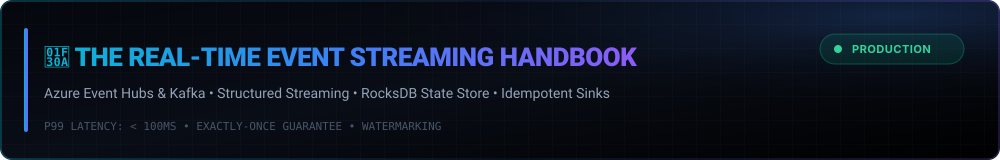
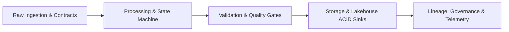
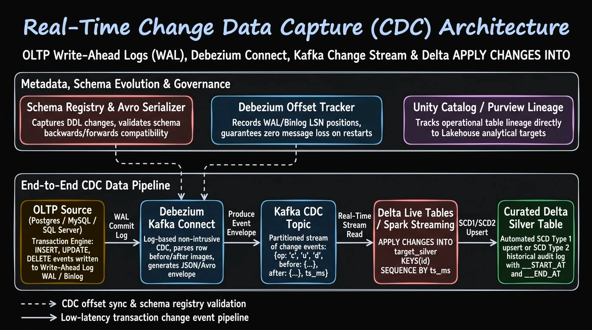
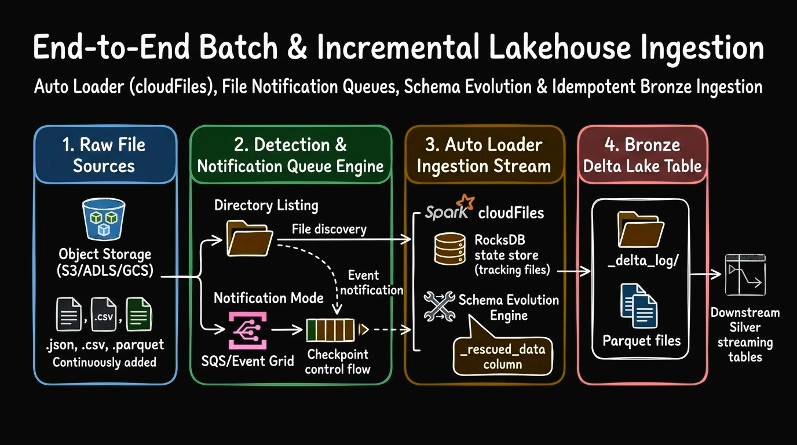
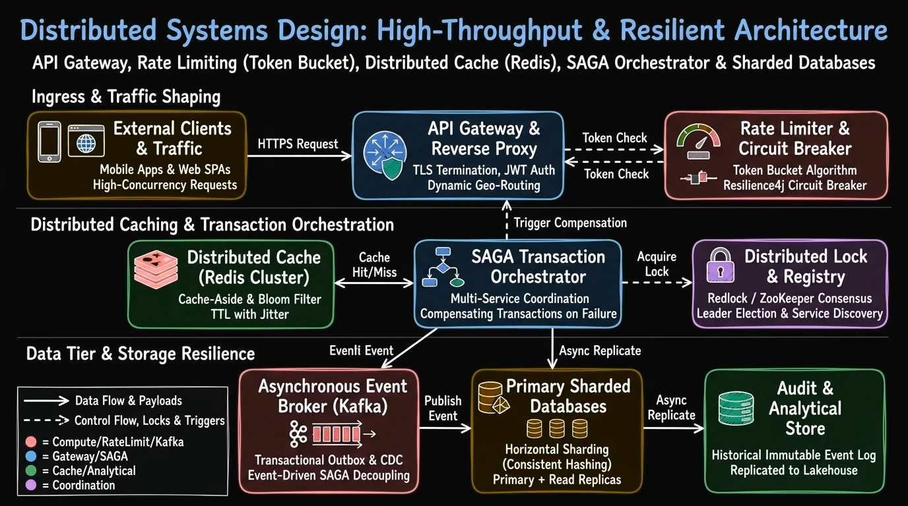
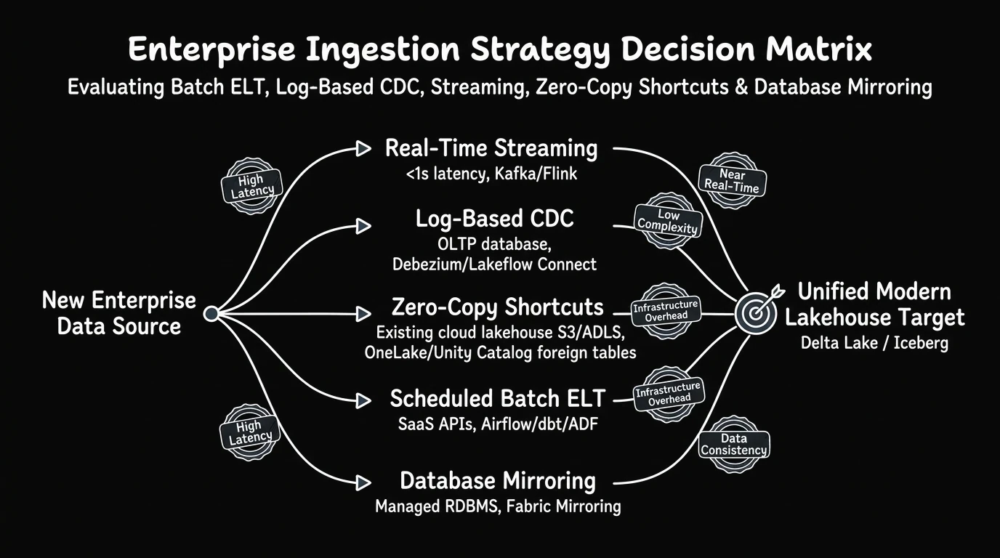

<p align="center">
  
</p>

# 🌊 The Real-Time Event Streaming & Ingestion Handbook

**Enterprise Reference Architecture, Production Incident Runbooks & 4-Tier Interview Preparation Matrix**

[](https://github.com/santoshjammi29/streaming-handbook/actions)
[](#)
[](LICENSE)

> Production Apache Kafka, Apache Flink, Debezium CDC, and stream-to-lakehouse exactly-once architectures.  
> Part of the **Modern Data Engineering & Lakehouse Systems Encyclopedia** ecosystem anchored by [**moderndataengineer.uk**](https://moderndataengineer.uk).

[Platform Architecture](#️-platform-architecture) • [Whiteboard Blueprints](#-whiteboard-blueprints) • [Interactive CLI](#-interactive-cli-explorer) • [Architectures](#️-architectural-deep-dives) • [Runbooks](#-production-incident-runbooks) • [Interview Matrix](#-4-tier-interview-preparation-matrix)  • [Core Concepts (76 Topics)](#-core-curriculum-concepts--topics) • [Sister Repositories](#-ecosystem-interlinking--sister-repositories)

---

## 🎯 Overview & Mission

Modern enterprise data systems require rigorous operational governance, predictable failure recovery, deterministic schemas, and observable pipeline execution.

This repository provides **battle-tested production specifications**:
- **4 Deep-Dive Architectural Blueprints**: In-depth engine mechanics, state stores, and Mermaid diagrams.
- **6 Production Incident Disaster Recovery Runbooks**: SEV-1 and SEV-2 playbooks with Emergency Decision Trees.
- **4-Tier Progressive Interview Matrix & 50 Flashcards**: Level 100 to Level 400 questions and active recall deck.
- **52 Whiteboard Blueprints**: Architectural infographics mirrored under `assets/whiteboards/`.
- **Interactive Terminal Shell**: Instant search and study directly from the terminal via `python scripts/interactive_shell.py`.

---

## 🚀 Quickstart & Setup

Set up your local stream processing environment and run validation in under 60 seconds:

```bash
# 1. Clone repository
git clone https://github.com/santoshjammi29/streaming-handbook.git
cd streaming-handbook

# 2. Set up virtual environment
python3 -m venv .venv
source .venv/bin/activate
pip install -r requirements.txt

# 3. Explore streaming architectures and runbooks via CLI
python3 scripts/interactive_shell.py --list
python3 scripts/run_tests.py
```

---

## 💻 Interactive CLI Explorer

Explore architectures, runbooks, and interview guides directly from your terminal:

```bash
# Browse catalog
python scripts/interactive_shell.py --list
python scripts/interactive_shell.py --runbooks
python scripts/interactive_shell.py --architectures
python scripts/interactive_shell.py --interview
python scripts/interactive_shell.py --ecosystem

# Run self-contained test suite
python scripts/run_tests.py
```

---

## 🏛️ Platform Architecture



---

## 🖼️ Master Whiteboard Architecture Blueprints

The repository includes **52 publication-grade architectural whiteboard blueprints** mirrored under [`assets/whiteboards/`](assets/whiteboards) and cataloged with comprehensive multi-persona breakdowns, failure modes, and engine internals in [`docs/whiteboard_diagrams/README.md`](docs/whiteboard_diagrams/README.md).

- 🖼️ **[Master Whiteboard Blueprints Hub](docs/whiteboard_diagrams/handbook_whiteboard_blueprints.md)**: Complete whiteboard architecture blueprints with storage vs. compute, control vs. data planes, memory tiers, and failure modes.
- 📊 **[Spark Architecture & Tuning Cheatsheet](assets/whiteboards/spark_architecture_catalyst_cheatsheet.jpg)**: High-resolution visual cheatsheet covering cluster topology, Catalyst compiler phases, and memory tiers.
- 🔀 **[Join Strategies Decision Matrix](assets/whiteboards/spark_join_strategies_decision_matrix.jpg)**: Visual flowchart and decision tree for distributed joins and broadcast thresholds.
- ⚡ **[Skew & Memory Spill Triage](assets/whiteboards/spark_performance_skew_spill_triage.jpg)**: Step-by-step diagnostic workflow for data skew, spill to disk, and OOM triage.

### 📐 Visual Blueprints Showcase

<table>
  <tr>
    <td width="50%" valign="top">
      <a href="docs/whiteboard_diagrams/README.md#kafka-event-streaming-pipeline">
        
      </a>
      <br><strong>Real-Time Event Streaming & Kafka Architecture</strong><br>
      <em>Distributed commit log, partition replication, consumer group rebalancing, and consumer lag.</em>
    </td>
    <td width="50%" valign="top">
      <a href="docs/whiteboard_diagrams/README.md#spark-streaming-state-store">
        
      </a>
      <br><strong>Spark Structured Streaming State Store & Watermarking Mechanics</strong><br>
      <em>RocksDB state store, event-time watermarking, and incremental state commit checkpoints.</em>
    </td>
  </tr>
  <tr>
    <td width="50%" valign="top">
      <a href="docs/whiteboard_diagrams/README.md#cdc-debezium-lakehouse-pipeline">
        
      </a>
      <br><strong>Real-Time Change Data Capture (CDC) Architecture</strong><br>
      <em>Log-based CDC using Debezium, Kafka Connect, and streaming ingestion into Bronze Delta.</em>
    </td>
    <td width="50%" valign="top">
      <a href="docs/whiteboard_diagrams/README.md#streaming-dlq-recovery-flow">
        
      </a>
      <br><strong>Stateful Streaming Failure Recovery & Dead-Letter Queue (DLQ) Remediation</strong><br>
      <em>Poison pill isolation, exponential backoff retries, and quarantine routing flows.</em>
    </td>
  </tr>
  <tr>
    <td width="50%" valign="top">
      <a href="docs/whiteboard_diagrams/README.md#lakehouse-ingestion-autoloader">
        
      </a>
      <br><strong>End-to-End Batch & Incremental Lakehouse Ingestion</strong><br>
      <em>Cloud storage file notification, schema evolution, and Auto Loader micro-batch ingestion.</em>
    </td>
    <td width="50%" valign="top">
      <a href="docs/whiteboard_diagrams/README.md#distributed-systems-resilience-architecture">
        
      </a>
      <br><strong>Distributed Systems Design: High-Throughput & Resilient Architecture</strong><br>
      <em>Circuit breaking, rate limiting, connection pooling, and resilient RPC topology.</em>
    </td>
  </tr>
  <tr>
    <td width="50%" valign="top">
      <a href="docs/whiteboard_diagrams/README.md#data-ingestion-strategy-matrix">
        
      </a>
      <br><strong>Enterprise Data Movement & Replication Strategy Decision Flow</strong><br>
      <em>Decision tree for batch vs micro-batch vs continuous streaming replication.</em>
    </td>
    <td width="50%" valign="top">
      <a href="docs/whiteboard_diagrams/README.md#lakehouse-acid-concurrency">
        
      </a>
      <br><strong>Lakehouse ACID Concurrency & Write Conflict Resolution Matrix</strong><br>
      <em>Two-phase commit, transactional sinks, and write conflict serialization.</em>
    </td>
  </tr>
</table>

> 🔍 **Explore all 52 blueprints with 5-persona breakdowns, failure modes, and engine internals in [docs/whiteboard_diagrams/README.md](docs/whiteboard_diagrams/README.md)**.

## 📦 Production Curriculum Modules

| Module | Title & Focus | Key Deliverables & Code |
| :---: | :--- | :--- |
| **01** | **[Kafka Storage Internals & Zero-Copy I/O](modules/01_kafka_storage_and_partitioning/README.md)** | Commit log segments (`.log`, `.index`, `.timeindex`), Linux `sendfile()` OS page cache, `server.properties` |
| **02** | **[Resilient Producers & Cooperative Consumers](modules/02_producers_consumers_and_consumer_groups/README.md)** | Idempotent producer (`acks=all`), sequence numbers, cooperative sticky rebalance, `producer_resilient.py` |
| **03** | **[Schema Registry & Binary Avro Serialization](modules/03_schema_registry_and_evolution/README.md)** | 5-byte wire framing, magic byte (`0x00`), backward/forward compatibility rules, `order_event.avsc` |
| **04** | **[Apache Flink Runtime & Chandy-Lamport](modules/04_flink_distributed_runtime/README.md)** | JobManager, TaskManager slots, streaming dataflow graphs, distributed barrier checkpointing |
| **05** | **[State Management & RocksDB Tuning](modules/05_state_management_and_rocksdb/README.md)** | ValueState, ListState, MapState, RocksDB off-heap memory allocation, state TTL, `stateful_dedup.py` |
| **06** | **[Event Time, Watermarks & Side Outputs](modules/06_event_time_watermarks_and_lateness/README.md)** | Bounded-out-of-orderness watermarks, late arriving data handling, dead-letter side outputs |
| **07** | **[Streaming Window Aggregations](modules/07_streaming_window_aggregations/README.md)** | Tumbling, sliding, session, and over windows; incremental aggregate vs full process window |
| **08** | **[CDC Log Mining & Debezium Connectors](modules/08_cdc_log_mining_and_debezium/README.md)** | Transactional log mining, Postgres `pgoutput` WAL parsing, MySQL binlogs, schema drift handling |
| **09** | **[End-to-End Exactly-Once Processing](modules/09_end_to_end_exactly_once/README.md)** | Two-Phase Commit Protocol (`TwoPhaseCommitSinkFunction`), idempotent transactional sinks |
| **10** | **[High-Throughput Stream-to-Lakehouse Sinks](modules/10_stream_to_lakehouse_sinks/README.md)** | PySpark Structured Streaming into Delta Lake / Iceberg, RocksDB state provider, `stream_to_delta.py` |

---

## 🏛️ Architectural Deep Dives

Four production-tested architectural specifications located under `architectures/`:

| Spec ID | Document Title | Target Level | Core Architectural Focus |
| :---: | :--- | :---: | :--- |
| **01** | **[Kafka Partition Storage & Consumer Group Protocol](architectures/01_kafka_storage_internals_and_consumer_groups.md)** | `Level 300-400` | Segment files, zero-copy index lookups, offset commit protocols, and rebalance algorithms. |
| **02** | **[Flink Distributed Runtime & Asynchronous Barrier Snapshots](architectures/02_flink_distributed_runtime_and_chandy_lamport.md)** | `Level 300-400` | Chandy-Lamport checkpointing, stream alignment, RocksDB state backends, and WAL sinks. |
| **03** | **[Change Data Capture (CDC) with Debezium & Kafka Connect](architectures/03_cdc_debezium_log_mining_architecture.md)** | `Level 300-400` | Database WAL mining (Postgres WAL, MySQL binlog), snapshotting, and tombstone event propagation. |
| **04** | **[Stream-to-Lakehouse Exactly-Once Ingestion](architectures/04_stream_to_lakehouse_exactly_once_mechanics.md)** | `Level 300-400` | Two-Phase Commit sinks, micro-batch coordination, and Delta/Iceberg atomic transaction logs. |

---

## 🚨 Production Incident Runbooks

Six operational disaster recovery runbooks located under `runbooks/`:

| Runbook ID | Title & Direct Link | Severity | Root Cause & Remediation Focus |
| :---: | :--- | :---: | :--- |
| **01** | **[Consumer Group Rebalance Storm & Lag Surge Triage](runbooks/01_consumer_group_rebalance_storm_triage.md)** | `SEV-1` | Triage max.poll.interval.ms expirations, heartbeats, and stop-the-world partition rebalances. |
| **02** | **[Flink Backpressure & Checkpoint Timeout Triage](runbooks/02_flink_backpressure_and_checkpoint_timeout_triage.md)** | `SEV-1` | Locate bottleneck operators, tune network buffer pools, and resolve unaligned checkpoints. |
| **03** | **[CDC Schema Drift & Database WAL Disk Exhaustion](runbooks/03_cdc_schema_drift_and_wal_exhaustion.md)** | `SEV-1` | Handle replication slot stalls, upstream disk 100% saturation, and schema evolution. |
| **04** | **[Corrupt Event Deserialization & DLQ Routing](runbooks/04_poison_pill_deserialization_dead_letter_queue.md)** | `SEV-2` | Isolate malformed payloads, unparseable JSON/Avro, and route safely to dead-letter topics. |
| **05** | **[Flink RocksDB Off-Heap Native Memory Leak Triage](runbooks/05_rocksdb_offheap_memory_leak_triage.md)** | `SEV-2` | Diagnose block cache over-allocation, write buffer spill, and container OS OOM kills. |
| **06** | **[Kafka Under-Replicated Partitions & Broker Failure Recovery](runbooks/06_kafka_under_replicated_partitions_disaster_recovery.md)** | `SEV-1` | Recover offline replicas, resolve leader election failures, and rebalance partition replicas. |

---

## 🎓 4-Tier Interview Preparation Matrix

Comprehensive technical interview guides and flashcard deck located under `interview/`:

| Tier | Role Target | Core Focus Areas | Direct Link |
| :---: | :--- | :--- | :---: |
| **Tier 1** | **Junior Streaming Engineer** | Kafka topics, partitions, producers, consumer offsets, basic serialization. | [`01_junior.md`](interview/01_junior_streaming_engineer.md) |
| **Tier 2** | **Mid-Level Streaming Engineer** | Consumer lag, Kafka Connect, Avro Schema Registry, Flink tumbling windows. | [`02_mid_level.md`](interview/02_mid_level_streaming_engineer.md) |
| **Tier 3** | **Senior Distributed Systems Engineer** | Chandy-Lamport state snapshots, RocksDB tuning, stream-stream joins, exact-once. | [`03_senior.md`](interview/03_senior_distributed_streaming_engineer.md) |
| **Tier 4** | **Staff & Principal Streaming Architect** | Multi-datacenter Kafka replication (MirrorMaker 2), capacity math, edge IoT ingest. | [`04_staff.md`](interview/04_staff_principal_streaming_architect.md) |
| **Deck** | **50 Rapid-Fire Flashcards** | 50 active recall questions and answers for technical mastery. | [`05_flashcards.md`](interview/05_flashcards_deck_50.md) |

---

## 🧠 Core Curriculum Concepts & Topics (76 Topics Covered)

> 💡 **Enterprise Knowledge Base Integration**: This repository implements **76 production topics** from the [Modern Data Engineering Systems Encyclopedia (921 Topics)](https://moderndataengineer.uk/concepts), grouped by **Relevant Functional Sections** and then by **Difficulty Level**. All sections are **collapsible and collapsed by default** for effortless navigation. Browse the full curriculum in [`topics/README.md`](topics/README.md).

### 📑 Topics Directory at a Glance

| Pillar / Module | Topic Count | Functional Sections Covered | Status |
|:---|:---:|:---|:---:|
| 🌊 **Real-Time Streaming Lakehouse, CDC & Table Formats** | **76** | Distributed State, CDC & Lakehouse Ingestion, Engine Vectorization & Hardware Acceleration, Open Table Formats (Iceberg, Delta, Hudi), and 1 more | ✅ Collapsible Deck |

<details>
<summary><b>🌊 Real-Time Streaming Lakehouse, CDC & Table Formats (76 Topics across 4 Sections)</b> — <i>Click to expand module</i></summary>

<details>
<summary>&nbsp;&nbsp;📂 <b>Section: Open Table Formats (Iceberg, Delta, Hudi) (22 Topics)</b></summary>

<details>
<summary>&nbsp;&nbsp;&nbsp;&nbsp;🟢 Easy: <b>🟢 Easy (Level 100) (1 Topics)</b></summary>

| # | Topic / Concept | Level | Architectural Definition & Core Principle |
|:---:|---|:---:|---|
| 1 | **Apache Iceberg Hidden Partitioning & Manifest List Architecture** | `🟢 Easy` | Decouples table partitioning from physical directory structures, avoiding Hive-style column path rewrites. |

</details>

<details>
<summary>&nbsp;&nbsp;&nbsp;&nbsp;🟡 Intermediate: <b>🟡 Intermediate (Level 200) (4 Topics)</b></summary>

| # | Topic / Concept | Level | Architectural Definition & Core Principle |
|:---:|---|:---:|---|
| 1 | **Apache Hudi Copy-On-Write (COW)** | `🟡 Intermediate` | A table type that rewrites entire Parquet data files upon receiving row updates, maximizing subsequent read scan speeds. |
| 2 | **Delta Lake Column Mapping** | `🟡 Intermediate` | A Delta Lake metadata feature that decouples logical column names exposed to users from physical column identifiers stored inside Parquet files. |
| 3 | **Delta Lake Deletion Vectors (DV) vs Copy-on-Write (CoW)** | `🟡 Intermediate` | Soft-delete bitmap index avoiding full Parquet file rewrites on UPDATE and DELETE operations. |
| 4 | **Delta Standalone Reader & Writer** | `🟡 Intermediate` | A lightweight JVM library that allows reading and writing Delta Lake tables directly without requiring an active Apache Spark cluster or runtime. |

</details>

<details>
<summary>&nbsp;&nbsp;&nbsp;&nbsp;🔴 Advanced: <b>🔴 Advanced (Level 300) (6 Topics)</b></summary>

| # | Topic / Concept | Level | Architectural Definition & Core Principle |
|:---:|---|:---:|---|
| 1 | **Apache Hudi Merge-On-Read (MOR)** | `🔴 Advanced` | A table type storing real-time updates in compact columnar log files, merging with base Parquet files during query execution. |
| 2 | **Apache Iceberg Partition Evolution** | `🔴 Advanced` | A table format capability that updates partitioning schemas (e.g. from month to day) without rewriting historical data or invalidating existing queries. |
| 3 | **Copy-on-Write vs Merge-on-Read Table Format Trade-offs** | `🔴 Advanced` | The fundamental write-latency versus read-amplification trade-off between rewriting entire data files on mutation versus appending delta deletion files. |
| 4 | **Delta Lake Soft Deletion Vectors** | `🔴 Advanced` | Binary vector files recording deleted row positions, decoupling mutations from 500MB Parquet rewrites. |
| 5 | **Iceberg Equality Deletes vs. Position Deletes** | `🔴 Advanced` | The two deletion vector mechanisms supported by Apache Iceberg v2 to handle row-level deletions and updates without full data file rewrites. |
| 6 | **Iceberg Snapshot Expiration** | `🔴 Advanced` | Purging historical Iceberg table metadata and unreferenced Parquet data files to reclaim cloud storage and bound manifest list scan latency. |

</details>

<details>
<summary>&nbsp;&nbsp;&nbsp;&nbsp;🟣 Architect: <b>🟣 Staff Architect (Level 400) (11 Topics)</b></summary>

| # | Topic / Concept | Level | Architectural Definition & Core Principle |
|:---:|---|:---:|---|
| 1 | **Apache Iceberg REST Catalog Open Specification** | `🟣 Architect` | A vendor-neutral OpenAPI protocol that standardizes how query engines discover namespaces, load table metadata pointers, and perform atomic multi-table commit transactions. |
| 2 | **Apache Iceberg REST Catalog Specification** | `🟣 Architect` | An open, vendor-neutral HTTP OpenAPI standard for metadata discovery, atomic commit coordination, and table credential vending across multi-engine lakehouses. |
| 3 | **Apache Polaris Catalog Federation** | `🟣 Architect` | An open-source centralized metadata catalog built on the Apache Iceberg REST specification, providing unified cross-cloud governance and multi-engine interoperability. |
| 4 | **Delta Lake Change Data Feed (CDC & table_changes TVF)** | `🟣 Architect` | A native Delta table capability that exposes row-level change events (inserts, update pre-images, update post-images, deletes) between table versions. |
| 5 | **Delta Lake Conflict Detection Matrix** | `🟣 Architect` | The formal concurrency matrix in Delta Lake defining which write operations (append, update, delete, compaction) can commit concurrently under WriteSerializable isolation. |
| 6 | **Delta Lake Deletion Vectors (Merge-on-Read)** | `🟣 Architect` | A storage optimization that shifts Delta Lake write operations from Copy-on-Write (CoW) to Merge-on-Read (MoR) using compact RoaringBitmap row tombstones. |
| 7 | **Delta Lake Liquid Clustering & Space-Filling Curves** | `🟣 Architect` | A dynamic layout optimization using Hilbert space-filling curves that replaces rigid Hive-style directory partitioning and manual Z-Ordering. |
| 8 | **Delta Lake UniForm (Universal Format)** | `🟣 Architect` | An open lakehouse capability that writes Delta Parquet data files once while generating Iceberg and Hudi metadata asynchronously for multi-engine zero-copy read interoperability. |
| 9 | **Lakehouse UniForm Hudi Interoperability** | `🟣 Architect` | Cross-engine interoperability standard converting Delta commit logs into Apache Hudi timeline commit files. |
| 10 | **Power BI Direct Lake Mode: In-Memory VertiPaq Paging** | `🟣 Architect` | Zero-copy semantic model serving directly from OneLake Delta Parquet without Import or DirectQuery latency. |
| 11 | **UniForm Iceberg Metadata Translator** | `🟣 Architect` | The background asynchronous daemon in Delta Lake that converts Delta action commits into Apache Iceberg metadata manifest trees. |

</details>

</details>

<details>
<summary>&nbsp;&nbsp;📂 <b>Section: Real-Time Streaming & Watermarking (3 Topics)</b></summary>

<details>
<summary>&nbsp;&nbsp;&nbsp;&nbsp;🔴 Advanced: <b>🔴 Advanced (Level 300) (2 Topics)</b></summary>

| # | Topic / Concept | Level | Architectural Definition & Core Principle |
|:---:|---|:---:|---|
| 1 | **Apache Paimon Streaming Lakehouse** | `🔴 Advanced` | A streaming lakehouse storage format developed for high-throughput changelog ingestion, sub-second real-time streaming updates, and primary-key upserts with Apache Flink. |
| 2 | **Structured Streaming Watermarking & Allowed Lateness** | `🔴 Advanced` | Threshold specifying how far event-time can lag behind maximum observed event-time before data is dropped. |

</details>

<details>
<summary>&nbsp;&nbsp;&nbsp;&nbsp;🟣 Architect: <b>🟣 Staff Architect (Level 400) (1 Topics)</b></summary>

| # | Topic / Concept | Level | Architectural Definition & Core Principle |
|:---:|---|:---:|---|
| 1 | **Debezium CDC & Analytical Stream Decoupling** | `🟣 Architect` | Debezium CDC is a distributed transaction log mining engine that captures row-level database changes in real time, streaming events into Kafka to decouple OLTP from analytical lakehouses. |

</details>

</details>

<details>
<summary>&nbsp;&nbsp;📂 <b>Section: Engine Vectorization & Hardware Acceleration (4 Topics)</b></summary>

<details>
<summary>&nbsp;&nbsp;&nbsp;&nbsp;🟢 Easy: <b>🟢 Easy (Level 100) (2 Topics)</b></summary>

| # | Topic / Concept | Level | Architectural Definition & Core Principle |
|:---:|---|:---:|---|
| 1 | **In-Process Analytics Revolution: DuckDB and Polars via Apache Arrow Zero-Copy** | `🟢 Easy` | Serverless local analytical engines sharing columnar memory without serialization or network hops. |
| 2 | **Parquet Vectorized Decoding & Predicate Pushdown** | `🟢 Easy` | SIMD-accelerated column decoding combined with metadata-driven row group skipping via min/max statistics. |

</details>

<details>
<summary>&nbsp;&nbsp;&nbsp;&nbsp;🟡 Intermediate: <b>🟡 Intermediate (Level 200) (1 Topics)</b></summary>

| # | Topic / Concept | Level | Architectural Definition & Core Principle |
|:---:|---|:---:|---|
| 1 | **Cross-Engine Data Manipulation (Rosetta Stone)** | `🟡 Intermediate` | The Cross-Engine Rosetta Stone is an architectural translation matrix mapping common data engineering operations across SQL, PySpark, Pandas, and Polars. |

</details>

<details>
<summary>&nbsp;&nbsp;&nbsp;&nbsp;🟣 Architect: <b>🟣 Staff Architect (Level 400) (1 Topics)</b></summary>

| # | Topic / Concept | Level | Architectural Definition & Core Principle |
|:---:|---|:---:|---|
| 1 | **Databricks Serverless Compute & Photon Vectorized C++ Engine** | `🟣 Architect` | Instant-on, fully managed C++ query engine separating cluster provisioning from SQL execution. |

</details>

</details>

<details>
<summary>&nbsp;&nbsp;📂 <b>Section: Distributed State, CDC & Lakehouse Ingestion (47 Topics)</b></summary>

<details>
<summary>&nbsp;&nbsp;&nbsp;&nbsp;🟡 Intermediate: <b>🟡 Intermediate (Level 200) (6 Topics)</b></summary>

| # | Topic / Concept | Level | Architectural Definition & Core Principle |
|:---:|---|:---:|---|
| 1 | **Apache Airflow 3.0 Asset-Driven Scheduling & Deferrable Operators** | `🟡 Intermediate` | Event-driven DAG execution triggered by dataset updates combined with async triggerer workers. |
| 2 | **Hybrid Search Retrieval over Lakehouse Tables** | `🟡 Intermediate` | An enterprise retrieval architecture that merges sparse keyword search (BM25) with dense vector embeddings to provide accurate, hallucination-resistant context for RAG agents. |
| 3 | **OpenLineage & Spark UI DAG Task Skew Diagnostics** | `🟡 Intermediate` | Open-source standard for runtime lineage collection paired with Spark UI partition duration metrics. |
| 4 | **Parquet ZSTD Level 7 Recompression** | `🟡 Intermediate` | A high-ratio columnar compression algorithm developed by Facebook, offering 35-40% smaller disk footprint than Snappy with virtually identical decompression speed. |
| 5 | **QUALIFY Clause Window Filtering** | `🟡 Intermediate` | The QUALIFY clause filters the results of window functions directly within a single SELECT statement without requiring nested subqueries or Common Table Expressions. |
| 6 | **Spark 4.0 AQE Dynamic Shuffle Coalescing & Skew Join Mitigation** | `🟡 Intermediate` | Runtime query plan adjustments based on actual shuffle statistics collected during stage execution. |

</details>

<details>
<summary>&nbsp;&nbsp;&nbsp;&nbsp;🔴 Advanced: <b>🔴 Advanced (Level 300) (9 Topics)</b></summary>

| # | Topic / Concept | Level | Architectural Definition & Core Principle |
|:---:|---|:---:|---|
| 1 | **AI Data Workload Unit Economics** | `🔴 Advanced` | The cost model for delivering one useful AI-enabled data task, including retrieval, query compute, model inference, storage, and human review. |
| 2 | **CAP & PACELC Theorem in Modern Data Stores** | `🔴 Advanced` | In a network partition (P), trade off Availability (A) vs Consistency (C). PACELC extends this: Else (E), trade off Latency (L) vs Consistency (C). |
| 3 | **Cosmos DB Request Units (RU/s) & Analytical Store (HTAP)** | `🔴 Advanced` | Hybrid Transactional/Analytical Processing isolating row-store OLTP from columnar analytical sync. |
| 4 | **Cross-Cloud Egress-Aware Data Placement** | `🔴 Advanced` | A placement decision that weighs compute location, data gravity, egress charges, latency, residency, and operational ownership across cloud boundaries. |
| 5 | **Databricks Asset Bundles (DABs) & Declarative DataOps Pipelines** | `🔴 Advanced` | Infrastructure-as-Code for lakehouses defining jobs, pipelines, and permissions in version-controlled YAML. |
| 6 | **Lakehouse Deletion Vectors for Right-to-be-Forgotten Compliance** | `🔴 Advanced` | The application of lightweight position deletion files to remove individual customer PII records from immutable Parquet tables in compliance with privacy regulations without rewriting historical files. |
| 7 | **Star Schema Many-to-Many Bridge Tables** | `🔴 Advanced` | A Bridge Table (junction table) is an intermediate modeling construct in a Kimball Star Schema that resolves many-to-many relationships between facts and dimensions without Cartesian fan-out. |
| 8 | **Unity Catalog 3-Level Namespace & Attribute-Based Access Control (ABAC)** | `🔴 Advanced` | Unified lakehouse governance with catalog.schema.table namespace and tag-based dynamic masking policies. |
| 9 | **Vector Indexing Architecture: HNSW vs IVF in Enterprise RAG** | `🔴 Advanced` | Trade-offs between graph-based Hierarchical Navigable Small World and inverted file cluster indexing. |

</details>

<details>
<summary>&nbsp;&nbsp;&nbsp;&nbsp;🟣 Architect: <b>🟣 Staff Architect (Level 400) (32 Topics)</b></summary>

| # | Topic / Concept | Level | Architectural Definition & Core Principle |
|:---:|---|:---:|---|
| 1 | **Architectural Decision Records (ADRs) for Data Platforms** | `🟣 Architect` | A lightweight, immutable document capturing significant technical architecture decisions, the historical context, explored alternatives, and accepted long-term trade-offs. |
| 2 | **Blameless Data Incident Postmortems & Cost of Downtime** | `🟣 Architect` | A structured, blameless retrospective methodology for analyzing production data outages, identifying systemic root causes, quantifying financial impact, and implementing permanent safeguards. |
| 3 | **Canary Data Pipeline Deployment & Abort Circuit** | `🟣 Architect` | A release strategy where new pipeline code or transformation logic processes a small fraction of live data or runs in parallel shadow mode before full production cutover. |
| 4 | **Clustered Columnstore Rowgroup Health** | `🟣 Architect` | Columnstore rowgroup health measures the size, compaction state, and row count of columnar rowgroups, where the optimal target is exactly 1,048,576 rows per compressed rowgroup. |
| 5 | **Column-Level Encryption & Tokenization (FPE)** | `🟣 Architect` | Cryptographic data protection mechanisms that encrypt or tokenize sensitive PII attributes while preserving original data formats and enabling analytical queries. |
| 6 | **Data Asset Sunsetting & Graveyard Archiving** | `🟣 Architect` | A formal decommission and archival lifecycle process that safely retires obsolete data assets, reclaims storage costs, and satisfies legal record retention compliance. |
| 7 | **Data Contract Specification & Drift Prevention** | `🟣 Architect` | An explicit, version-controlled agreement between data producers and consumers specifying schema definitions, business semantics, SLA guarantees, and change management protocols. |
| 8 | **Data FinOps Unit Economics & Workload Right-Sizing** | `🟣 Architect` | The practice of measuring and optimizing cloud data platform expenditures by attributing costs to granular business units, product features, and computational workloads. |
| 9 | **Data Incident Severity Matrix & Escalation Routing** | `🟣 Architect` | A standardized taxonomy defining incident severity levels (SEV-1 to SEV-4) based on consumer impact, with automated paging and response time service levels. |
| 10 | **Data Mesh Federated Governance & Data Product Contracts (ODCS)** | `🟣 Architect` | Decentralized domain ownership with centralized automated compliance and declarative schema contracts. |
| 11 | **Data Product Intake & Problem Framing** | `🟣 Architect` | A formal engineering discovery gate that captures business problem statements, baseline metrics, downstream decision cycles, and platform risk tiering before technical design commences. |
| 12 | **Data SLA, SLO & Error Budget Specification** | `🟣 Architect` | A quantifiable framework translating business expectations into measurable pipeline metrics: Service Level Indicators (SLIs), Service Level Objectives (SLOs), and enforceable Service Level Agreements (SLAs). |
| 13 | **DataOps Testing Pyramid & Quality Assertions** | `🟣 Architect` | A structured testing hierarchy spanning unit tests, integration tests, contract verification, and production data quality assertions (Great Expectations, Soda). |
| 14 | **Dead-Letter Queue (DLQ) Quarantine Architecture** | `🟣 Architect` | An isolation mechanism that routes malformed, corrupted, or non-conforming data records to a quarantined storage queue without halting primary pipeline execution. |
| 15 | **Devcontainers & Ephemeral Data Sandboxes** | `🟣 Architect` | Containerized, reproducible local and cloud-based development environments that allow data engineers to spin up identical toolchains and isolated test databases in seconds. |
| 16 | **Dual-Region Lakehouse Disaster Recovery & RPO/RTO** | `🟣 Architect` | An enterprise business continuity architecture featuring automated metadata synchronization, cross-region object storage replication, and rehearsed failover procedures. |
| 17 | **Fabric Capacity Smoothing & Bursting 24-Hour Windows** | `🟣 Architect` | Resource management model amortizing heavy compute bursts over rolling multi-hour evaluation periods. |
| 18 | **Federated Metadata Control Plane** | `🟣 Architect` | A governance architecture that lets distributed catalogs and data products share discovery and policy context without requiring every dataset to move into one store. |
| 19 | **FinOps Cost Attribution Matrix for Shared Catalogs** | `🟣 Architect` | The allocation framework that attributes compute, storage, and egress spend back to specific business units and data products across shared enterprise lakehouse infrastructure. |
| 20 | **FinOps DBU/Credit Allocation & Query Result Cache Reuse** | `🟣 Architect` | System table telemetry tracking compute spend with multi-tier cache hits across SQL Warehouses. |
| 21 | **Idempotent Pipeline Patterns & Replay Safety** | `🟣 Architect` | A pipeline architectural design ensuring that executing a data transformation multiple times with identical inputs produces the exact same output without duplicates or data corruption. |
| 22 | **Lakehouse Active-Passive Multi-Region Disaster Recovery** | `🟣 Architect` | An enterprise disaster recovery pattern that replicates lakehouse table metadata and underlying object files to a secondary cloud region to meet strict RPO and RTO recovery mandates. |
| 23 | **Model Context Protocol (MCP) & Lakehouse RAG Vector Search** | `🟣 Architect` | Standardized protocol connecting LLMs to lakehouse metadata and managed vector search indexes. |
| 24 | **Multi-Signal Data Observability & SLO Management** | `🟣 Architect` | A comprehensive operational framework that continuously monitors the five pillars of data health (freshness, volume, schema, quality, and lineage) against defined Service Level Objectives (SLOs). |
| 25 | **Open Lakehouse Interoperability Contract** | `🟣 Architect` | A tested agreement for how multiple engines discover, read, write, and govern shared table data and metadata. |
| 26 | **Policy-as-Code Guardrails for Data Infrastructure** | `🟣 Architect` | The automated enforcement of organizational security, compliance, and FinOps policies through code-defined rules evaluated during CI/CD infrastructure deployments. |
| 27 | **Production Readiness Review (PRR) for Data Products** | `🟣 Architect` | A structured architectural review checklist conducted before promoting a data product to production, verifying operational readiness across security, reliability, observability, and support. |
| 28 | **ScyllaDB C++ Seastar Asynchronous Engine vs JVM Cassandra** | `🟣 Architect` | Share-nothing, thread-per-core asynchronous C++ database architecture eliminating JVM GC latency. |
| 29 | **Supply Chain Levels for Software Artifacts (SLSA) in Data** | `🟣 Architect` | A security framework of standards and verifiable build attestations that protect data pipeline packages, container images, and ML models from tampering throughout the software supply chain. |
| 30 | **The 11 Modern Database Paradigms** | `🟣 Architect` | The 11 Database Paradigms classify storage systems by data structure, access patterns, and consistency guarantees to prevent anti-patterns in polyglot persistence. |
| 31 | **Trunk-Based Development for Data Platforms** | `🟣 Architect` | A source-control branching strategy where data engineers merge small, frequent commits into a single core branch (trunk/main), avoiding long-lived feature branches and merge hell. |
| 32 | **Zero-Downtime Expand/Contract Data Migration** | `🟣 Architect` | A phased database and schema refactoring pattern that guarantees 100% continuous uptime and compatibility across active producers and consumers during major table schema evolutions. |

</details>

</details>

</details>

## 🌐 Ecosystem Interlinking & Sister Repositories

The Modern Data Engineering Lakehouse Ecosystem is an integrated suite of 14 production-grade, specialized repositories anchored by the **[Modern Data Engineer Platform (`moderndataengineer.uk`)](https://github.com/santoshjammi29/moderndataengineer)**. Use this cross-reference matrix to navigate directly between complementary implementations across our repositories:

| Repository | Focus & Domain | Tightly Coupled Cross-Reference & Integration Points |
| :--- | :--- | :--- |
| **[Azure Databricks Blueprints](https://github.com/santoshjammi29/azure-databricks-project-blueprints)** | 3 Enterprise Reference Architectures | • **Project 02 Payments Fraud & AML**: End-to-end streaming over Azure Event Hubs with low-latency alert generation.<br>• **Off-Heap RocksDB State Store**: Managing multi-gigabyte sliding velocity windows for fraud scoring. |
| **[The PySpark Handbook](https://github.com/santoshjammi29/pyspark-handbook)** | Apache Spark 3.5+, Catalyst & Arrow UDFs | • **Structured Streaming Internals**: Watermarking lateness thresholds, stream-static joins, and trigger execution modes.<br>• **Tungsten Memory**: Off-heap buffer allocation preventing garbage collection pauses during streaming. |
| **[The Databricks Handbook](https://github.com/santoshjammi29/databricks-handbook)** | 105 Databricks Production Recipes & Unity Catalog | • **Lakeflow Pipelines & Auto Loader**: Declarative streaming ETL, streaming tables, and incremental ingestion into Delta Lake.<br>• **Predictive Optimization**: Automated compaction for streaming tables with high append frequencies. |
| **[Spark Experiments](https://github.com/santoshjammi29/spark-experiments)** | Empirical Skew, Salting & Spill Laboratory | • **Streaming Shuffle Memory Tuning**: Benchmarking stateful streaming joins under simulated event-time skew.<br>• **Micro-batch Profiling**: Profiling task duration percentiles across continuous streaming micro-batches. |
| **[Banking Risk Lakehouse](https://github.com/santoshjammi29/enterprise-banking-risk-alm-lakehouse)** | Regulated Financial Lakehouse (BCBS 239 & IFRS 9) | • **Project 3 Commercial Lending EWS**: Continuous transaction monitoring with 30-day sliding liquidity windows.<br>• **Dead-Letter Queues**: Quarantine workflows for malformed payment events without pipeline halting. |
| **[DataOps & CI/CD Handbook](https://github.com/santoshjammi29/dataops-cicd-handbook)** | Platform Engineering & GitOps | • **Streaming Operational Runbooks**: Managing checkpoint directories, offset invalidation recovery, and canary deployments.<br>• **Infrastructure as Code**: Provisioning Kafka clusters and Event Hubs namespaces using Terraform and Bicep. |
| **[The SQL Handbook](https://github.com/santoshjammi29/sql-handbook)** | Relational Query Engines, MPP & Concurrency | • **Streaming SQL Transformations**: Tumbling and sliding window aggregations, watermarking syntax, and append-only sinks.<br>• **CDC Debezium Ingestion**: Mining relational transaction logs and streaming to analytical targets. |
| **[The dbt Handbook](https://github.com/santoshjammi29/dbt-handbook)** | Analytics Engineering, dbt Mesh & Contracts | • **Microbatch Streaming Ingestion**: dbt incremental models consuming from real-time Kafka landing tables.<br>• **Change Data Capture**: Modeling Debezium CDC change streams into conformed analytical dimensions. |
| **[System Design Handbook](https://github.com/santoshjammi29/data-system-design-handbook)** | Distributed Storage, Table Formats & BCDR | • **Distributed Commit Logs**: Partition replication, KRaft consensus, consumer lag monitoring, and end-to-end exactly-once.<br>• **Disaster Recovery**: Cross-region streaming failover with offset synchronization. |
| **[Azure Cheat Sheet](https://github.com/santoshjammi29/azure-cheat-sheet)** | Fabric OneLake, Synapse & Azure Infrastructure | • **Azure Event Hubs & IoT Hub**: Managing multi-million event/sec streaming endpoints with Kafka surface compatibility.<br>• **Fabric Eventhouse**: Real-time KQL database streaming with forward-looking Delta sync to OneLake. |
| **[Interview Handbook](https://github.com/santoshjammi29/data-engineering-interview-handbook)** | Architectural Defense Playbooks & Concepts | • **Pillar 16 & Playbook 02 Defense**: Flink Chandy-Lamport barriers, RocksDB tuning, Kafka EOS, and watermark lateness.<br>• **Playbook 06 High-Throughput**: Sub-50ms fraud detection architecture and recovery playbooks. |
| **[The Security Handbook](https://github.com/santoshjammi29/security-handbook)** | Enterprise Cloud Security, Zero Trust & Lakehouse Governance | • **Zero Trust Lakehouse Perimeter**: Private endpoints, NSGs, and Azure Key Vault envelope encryption.<br>• **Workload Identity Federation**: Keyless GitHub Actions OIDC and Azure Managed Identities. |
| **[Modern Data Engineer Hub](https://github.com/santoshjammi29/moderndataengineer)** | Central Edge Presentation Platform | • **Interactive Whiteboard Viewer**: Pan, zoom, and inspect all 52 blueprints at [moderndataengineer.uk/whiteboards](https://moderndataengineer.uk/whiteboards).<br>• **Concept Encyclopedia**: 921 verified topics across real-time streaming and event architectures. |

## 📜 License

Distributed under the **[MIT License](LICENSE)**. Maintained with ❤️ by [Santosh Jammi](https://github.com/santoshjammi29) (2026).

---

## 🗺️ Interactive Curriculum Roadmap & Contributing

- **[Interactive Roadmap & Checkbox Tracker](ROADMAP.md)**: Track your personal progress across all 4 Mastery Tiers (`Level 100` to `Level 400`).
- **[Curriculum Taxonomy & Standards](TAXONOMY.md)**: Canonical controlled vocabulary, pillar mappings, and evidence standards.
- **[Contributing Guidelines](CONTRIBUTING.md)**: Authoring standards enforcing the Code-Test-Doc Triad and Anti-Pattern comparisons.
- **[Live Platform Hub](https://moderndataengineer.uk)**: Access the full 11,280+ record search engine, mindmaps, and vector PDF downloads.
