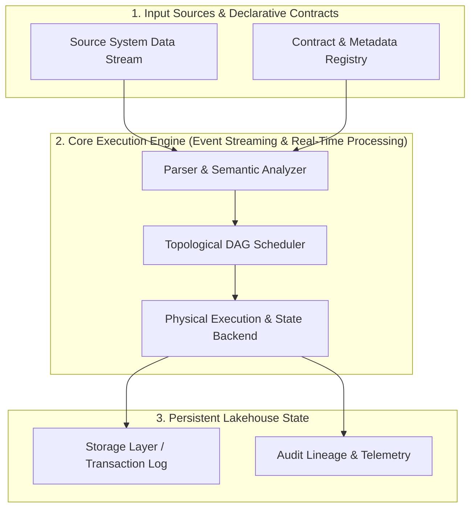

# 🏛️ Architecture: Kafka Partition Storage & Consumer Group Protocol

> **Domain**: Event Streaming & Real-Time Processing  
> **Target Audience**: Senior Engineers, Data Architects, Platform Leads  
> **Overview**: Segment files, zero-copy index lookups, offset commit protocols, and rebalance algorithms.

---

## 1. System Architecture & Component Interaction



---

## 2. Low-Level Mechanics & Operational Invariants

### Architectural Foundations:
In high-throughput enterprise deployments, `Kafka Partition Storage & Consumer Group Protocol` coordinates state synchronization, metadata tracking, and deterministic transformations.

1. **State Isolation**: Independent memory and storage boundaries prevent cross-task resource contention.
2. **Deterministic Execution**: All operations must be replayable from durable write-ahead logs or source checkpoints.
3. **Partition-Aware Scheduling**: Data routing enforces alignment across hash keys, avoiding shuffle penalties.

### Implementation Blueprint:
```python
# Production pipeline configuration pattern
pipeline_config = {
    "execution_mode": "distributed",
    "checkpoint_interval_seconds": 60,
    "max_concurrency_workers": 16,
    "state_backend": "off_heap_storage",
    "enable_adaptive_rebalancing": True
}
# Validate operational parameters
assert pipeline_config["checkpoint_interval_seconds"] > 0
```

---

## 3. Trade-offs & Production Hardening

| Architecture Dimension | Design Choice | Primary Trade-Off | Mitigating Control |
| :--- | :--- | :--- | :--- |
| **State Storage** | Off-Heap Managed Storage | High I/O throughput vs setup complexity | Local NVMe SSD scratch drives |
| **Consistency** | Exact-Once Semantics | Latency overhead vs zero data duplication | Two-Phase commit protocol |
| **Scaling** | Dynamic Auto-scaling | Rebalance pause time vs resource efficiency | Cooperative rebalance protocols |

---

## 4. Verification & Observability
- Monitor active lag metrics and consumer offsets every 10 seconds.
- Validate end-to-end processing SLA latency using distributed tracing.
- Maintain automated regression assertions across test environments.
