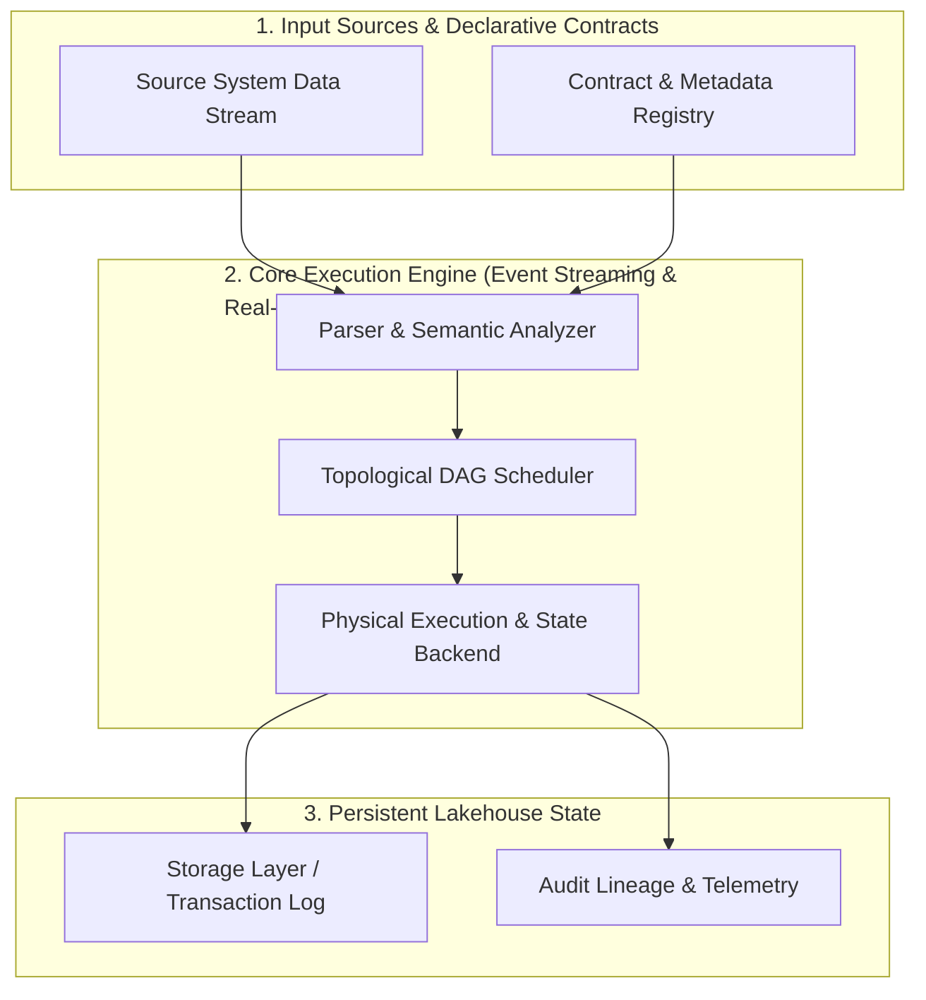
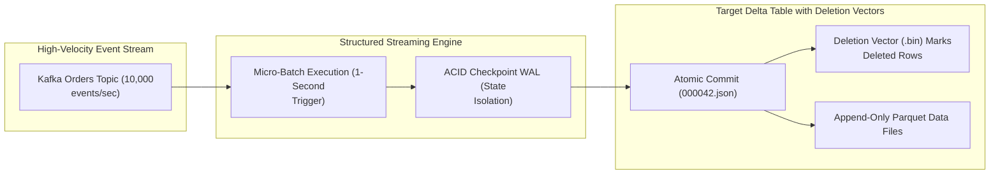

# 🏛️ Architecture: Stream-to-Lakehouse Exactly-Once Ingestion


> *Architectural Blueprint: [Stateful Streaming Failure Recovery & Dead-Letter Queue (DLQ) Remediation](../docs/whiteboard_diagrams/README.md#streaming-dlq-recovery-flow). View full multi-persona breakdown and engine mechanisms in the master index.*


> *Architectural Blueprint: [Lakehouse ACID Concurrency & Write Conflict Resolution Matrix](../docs/whiteboard_diagrams/README.md#lakehouse-acid-concurrency). View full multi-persona breakdown and engine mechanisms in the master index.*

> **Domain**: Event Streaming & Real-Time Processing  
> **Target Audience**: Senior Engineers, Data Architects, Platform Leads  
> **Overview**: Two-Phase Commit sinks, micro-batch coordination, and Delta/Iceberg atomic transaction logs.

---

## 1. System Architecture & Component Interaction



---

## 2. Low-Level Mechanics & Operational Invariants

### Architectural Foundations:
In high-throughput enterprise deployments, `Stream-to-Lakehouse Exactly-Once Ingestion` coordinates state synchronization, metadata tracking, and deterministic transformations.

1. **State Isolation**: Independent memory and storage boundaries prevent cross-task resource contention.
2. **Deterministic Execution**: All operations must be replayable from durable write-ahead logs or source checkpoints.
3. **Partition-Aware Scheduling**: Data routing enforces alignment across hash keys, avoiding shuffle penalties.

### Implementation Blueprint:
```python
# Production pipeline configuration pattern
pipeline_config = {
    "execution_mode": "distributed",
    "checkpoint_interval_seconds": 60,
    "max_concurrency_workers": 16,
    "state_backend": "off_heap_storage",
    "enable_adaptive_rebalancing": True
}
# Validate operational parameters
assert pipeline_config["checkpoint_interval_seconds"] > 0
```

---

## 3. Trade-offs & Production Hardening

| Architecture Dimension | Design Choice | Primary Trade-Off | Mitigating Control |
| :--- | :--- | :--- | :--- |
| **State Storage** | Off-Heap Managed Storage | High I/O throughput vs setup complexity | Local NVMe SSD scratch drives |
| **Consistency** | Exact-Once Semantics | Latency overhead vs zero data duplication | Two-Phase commit protocol |
| **Scaling** | Dynamic Auto-scaling | Rebalance pause time vs resource efficiency | Cooperative rebalance protocols |

---

## 4. Verification & Observability
- Monitor active lag metrics and consumer offsets every 10 seconds.
- Validate end-to-end processing SLA latency using distributed tracing.
- Maintain automated regression assertions across test environments.

---

## 4. Real-Time Stream-to-Lakehouse Exactly-Once with Deletion Vectors

Ingesting high-velocity streaming records directly into Delta Lake 3.x utilizes **Merge-on-Read Deletion Vectors**, eliminating write-amplification and write-write conflicts across concurrent streaming sinks.



### Production Implementation: PySpark Structured Streaming with Delta MERGE
```python
# Streaming upsert into Delta Lake with Deletion Vectors
def upsert_to_delta(micro_batch_df, batch_id):
    micro_batch_df.createOrReplaceTempView("updates")
    sql_merge = """
        MERGE INTO prod_catalog.silver.orders AS target
        USING updates AS source
        ON target.order_id = source.order_id
        WHEN MATCHED THEN UPDATE SET *
        WHEN NOT MATCHED THEN INSERT *
    """
    micro_batch_df._jdf.sparkSession().sql(sql_merge)

(spark.readStream
    .format("kafka")
    .option("kafka.bootstrap.servers", "kafka:9092")
    .option("subscribe", "orders-stream")
    .load()
    .writeStream
    .foreachBatch(upsert_to_delta)
    .option("checkpointLocation", "abfss://checkpoints@datalake.dfs.core.windows.net/orders_sink")
    .start())
```

### Key Ingestion Invariants:
- **Zero Micro-Batch Lock Contention**: Deletion vectors prevent concurrent streaming appends and background updates from blocking each other on the same partition.
- **Strict Idempotency**: ForeachBatch commits atomically to the Delta transaction log, ensuring exactly-once processing even across cluster restart recovery.
