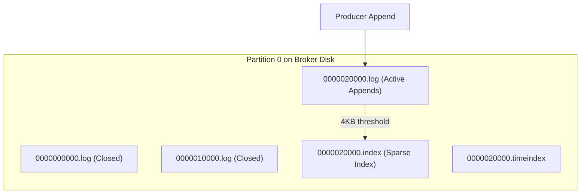

# Module 01: Kafka Storage Internals, Log Segments & Zero-Copy I/O

> *Architectural Blueprint: [Real-Time Event Streaming & Kafka Architecture](../../docs/whiteboard_diagrams/README.md#kafka-event-streaming-pipeline). View full multi-persona breakdown and engine mechanisms in the master index.*

## 1. Physical Storage Architecture
Kafka partitions are organized into sequential disk segments:
- `.log`: Raw binary messages written sequentially.
- `.index`: Sparse index mapping logical offsets to physical byte positions in `.log`.
- `.timeindex`: Sparse index mapping message timestamps to logical offsets.

## 2. Zero-Copy `sendfile()` Network Transfer
Kafka bypasses JVM application memory buffers during consumer reads. By leveraging Linux `sendfile()` system calls, data transfers directly from OS Page Cache to Network Socket buffers, minimizing CPU overhead and context switching.
