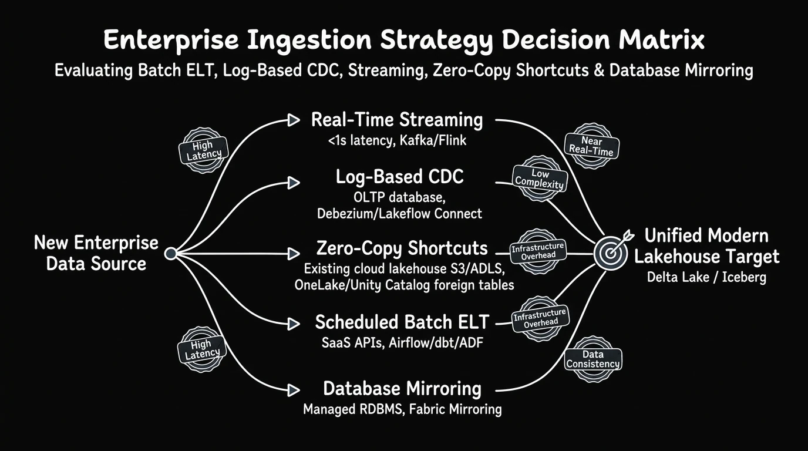

# Module 02: Resilient Producers, Consumers & Cooperative Sticky Rebalance

> *Architectural Blueprint: [Enterprise Data Movement & Replication Strategy Decision Flow](../../docs/whiteboard_diagrams/README.md#data-ingestion-strategy-matrix). View full multi-persona breakdown and engine mechanisms in the master index.*

## 1. Idempotent Producer Mechanics
Setting `enable.idempotence=true` guarantees exactly-once delivery within a single session:
- The broker assigns a unique Producer ID (PID).
- Each batch receives a monotonic Sequence Number per partition.
- The broker de-duplicates any retransmitted batches automatically.
