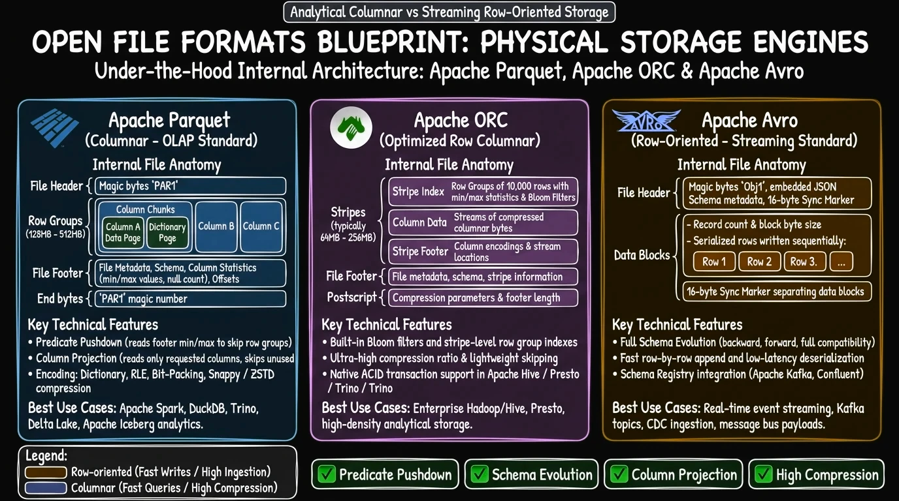

# Module 03: Confluent Schema Registry & Binary Avro Serialization

> *Architectural Blueprint: [Open File Formats Blueprint: Physical Storage Engines](../../docs/whiteboard_diagrams/README.md#open-file-formats-storage). View full multi-persona breakdown and engine mechanisms in the master index.*

## 1. Wire Format Wire Framing
Messages registered with Schema Registry prepend a 5-byte header to the payload:
- **Byte 0**: Magic Byte (`0x00`).
- **Bytes 1-4**: 4-byte Schema ID registered in Schema Registry.
- **Bytes 5+**: Raw Avro/Protobuf binary serialized payload.
