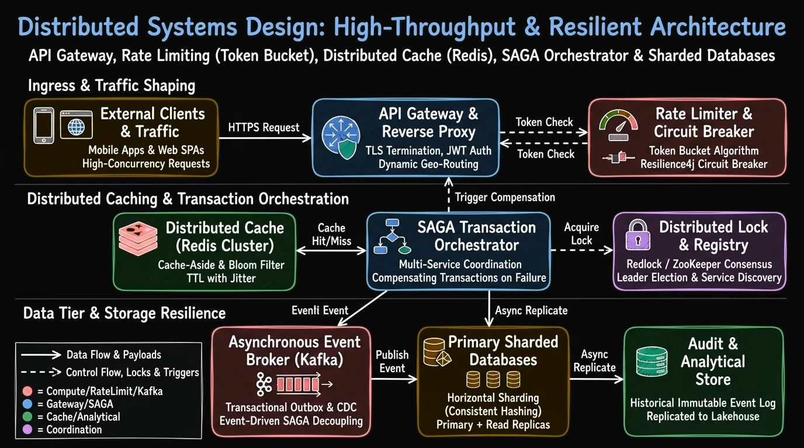

# Module 04: Apache Flink Distributed Architecture & Chandy-Lamport

> *Architectural Blueprint: [Distributed Systems Design: High-Throughput & Resilient Architecture](../../docs/whiteboard_diagrams/README.md#distributed-systems-resilience-architecture). View full multi-persona breakdown and engine mechanisms in the master index.*

## 1. Flink Runtime Architecture
- **JobManager**: Master coordinator. Manages resource allocation, job scheduling, checkpoint coordinator, and failover recovery.
- **TaskManager**: Worker JVMs. Executes Task Slots. Maintains in-memory operators and RocksDB state instances.
- **Chandy-Lamport Checkpointing**: Injects barrier tokens into data streams. When an operator receives barriers from all input channels, it takes an asynchronous snapshot of its local state without halting processing.
