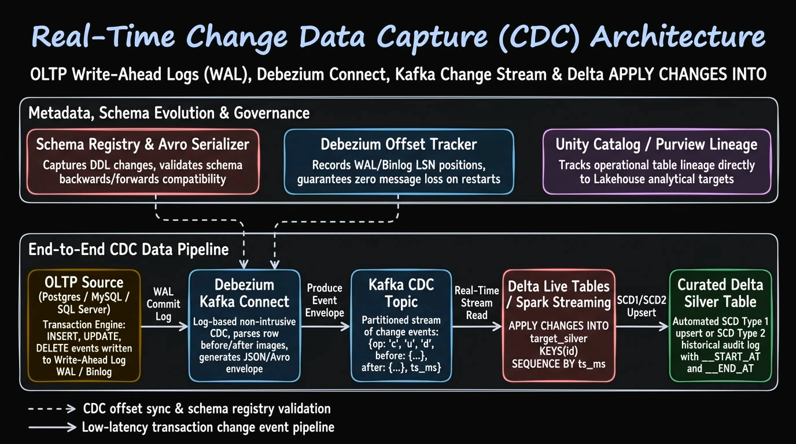

# Module 08: CDC Log Mining & Debezium Connector Architecture

> *Architectural Blueprint: [Real-Time Change Data Capture (CDC) Architecture](../../docs/whiteboard_diagrams/README.md#cdc-debezium-lakehouse-pipeline). View full multi-persona breakdown and engine mechanisms in the master index.*

## 1. Transactional Log Mining
Debezium attaches to the database write-ahead log (WAL) without executing expensive SELECT queries:
- PostgreSQL: `pgoutput` plugin reads logical replication slots.
- MySQL: Connects as a replica and parses binlog row events.
- Emits envelope records containing `before`, `after`, and transaction metadata (`op: c, u, d`).
