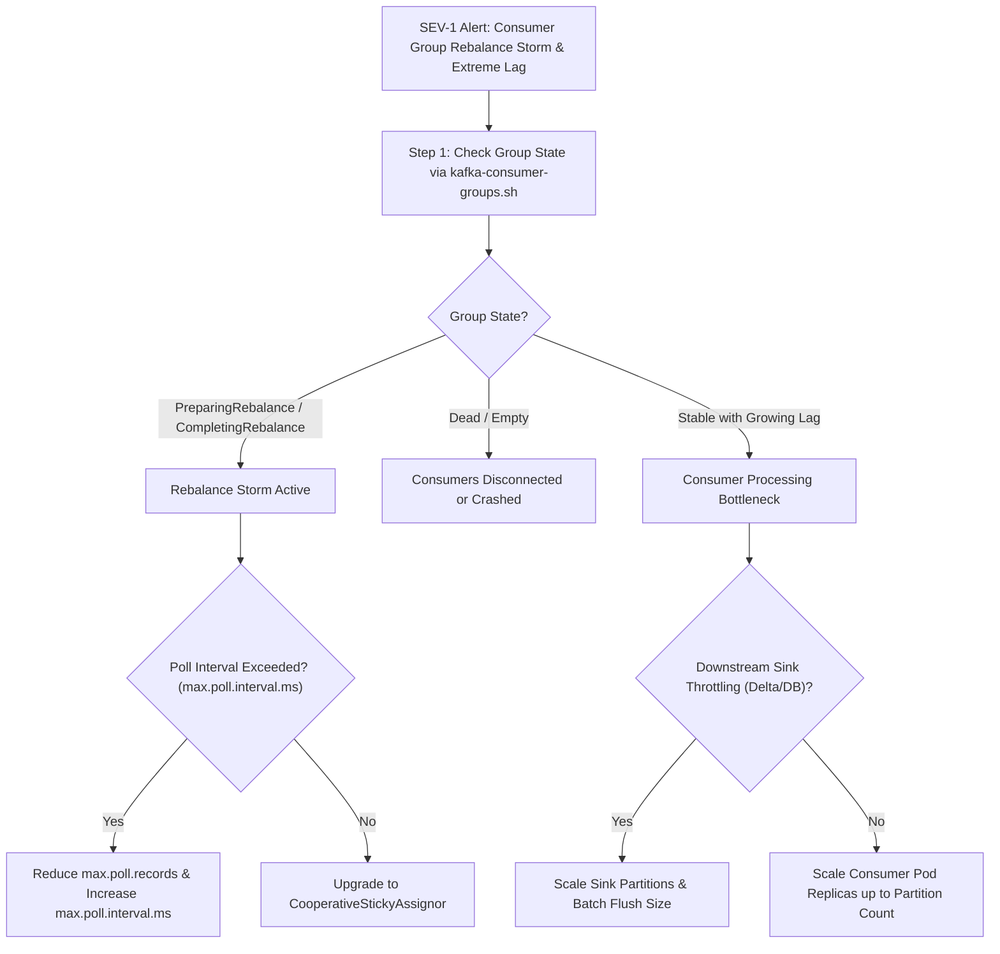

# 🚨 Production Runbook 01: Consumer Group Rebalance Storm & Lag Surge Triage

> **Incident Severity**: `SEV-1`  
> **Domain**: Apache Kafka & Real-Time Event Streaming  
> **Target Systems**: Kafka Brokers (KRaft / ZooKeeper), Consumer Clients (Java / Python / Go), Prometheus / Grafana  
> **Objective**: Stop cascading stop-the-world partition rebalances, eliminate lag spikes, and restore consumer group stability.

---

## 1. Emergency Decision Tree



---

## 2. Immediate Diagnostic Procedures (First 5 Minutes)

### Step 1: Query Consumer Group State and Partition Lag
Run `kafka-consumer-groups.sh` to determine if the group is trapped in a continuous rebalance loop:
```bash
# Check group state and member assignment
kafka-consumer-groups.sh --bootstrap-server "$KAFKA_BOOTSTRAP_SERVERS"   --describe --group "payments-processing-group" --state

# Inspect per-partition lag and identify straggling client IDs
kafka-consumer-groups.sh --bootstrap-server "$KAFKA_BOOTSTRAP_SERVERS"   --describe --group "payments-processing-group"
```

### Step 2: Check Client Log Signatures for Poll Timeouts
Search consumer logs for heartbeat failures and revoked partitions:
```bash
# Look for max.poll.interval.ms expiration (client evicted by coordinator)
grep -E "CommitFailedException|Revoking previously assigned partitions|max.poll.interval.ms" /var/log/kafka/consumer.log | tail -n 25
```

---

## 3. Root Cause Analysis & Production Remediation

### Primary Root Cause
In 90% of production incidents, rebalance storms occur because:
1. **Batch Processing Time > `max.poll.interval.ms`**: Downstream writes (e.g. to Delta Lake or PostgreSQL) stall, causing consumer poll thread to miss the timeout window. The Group Coordinator assumes the consumer is dead and initiates a rebalance.
2. **Eager Assignment Protocol**: The default `RangeAssignor` revokes *all* partitions globally across *all* consumers during a rebalance, causing an entire cluster outage for 30–90 seconds per churn.

### Production Remediation & Configuration Tuning

#### Phase 1: Switch to Incremental Cooperative Rebalancing
Switch consumer client config from eager assignor to `CooperativeStickyAssignor`:
```properties
# kafka-consumer.properties
partition.assignment.strategy=org.apache.kafka.clients.consumer.CooperativeStickyAssignor
max.poll.records=100
max.poll.interval.ms=600000
session.timeout.ms=45000
heartbeat.interval.ms=15000
```

#### Phase 2: Production Python Consumer Ingestion Loop
```python
from confluent_kafka import Consumer, KafkaError, TopicPartition
import time

conf = {
    'bootstrap.servers': 'kafka-broker-1:9092,kafka-broker-2:9092',
    'group.id': 'payments-processing-group',
    'auto.offset.reset': 'earliest',
    'enable.auto.commit': False,
    'partition.assignment.strategy': 'cooperative-sticky',
    'max.poll.interval.ms': 600000,
    'session.timeout.ms': 45000,
}

consumer = Consumer(conf)
consumer.subscribe(['payments.tx.v1'])

try:
    while True:
        msg = consumer.poll(timeout=1.0)
        if msg is None:
            continue
        if msg.error():
            if msg.error().code() == KafkaError._PARTITION_EOF:
                continue
            else:
                raise Exception(msg.error())
        
        # Process transaction within bounded SLA (< 50ms)
        process_payment_event(msg.value())
        consumer.commit(asynchronous=True)
except KeyboardInterrupt:
    pass
finally:
    consumer.close()
```

---

## 4. Verification & Prevention
- [ ] Verify `kafka-consumer-groups.sh --describe` shows state `Stable`.
- [ ] Confirm `rebalance-rate` in Grafana drops to zero.
- [ ] Set alert on Prometheus metric `kafka_consumergroup_lag > 50000` with 5-minute sustained threshold.
