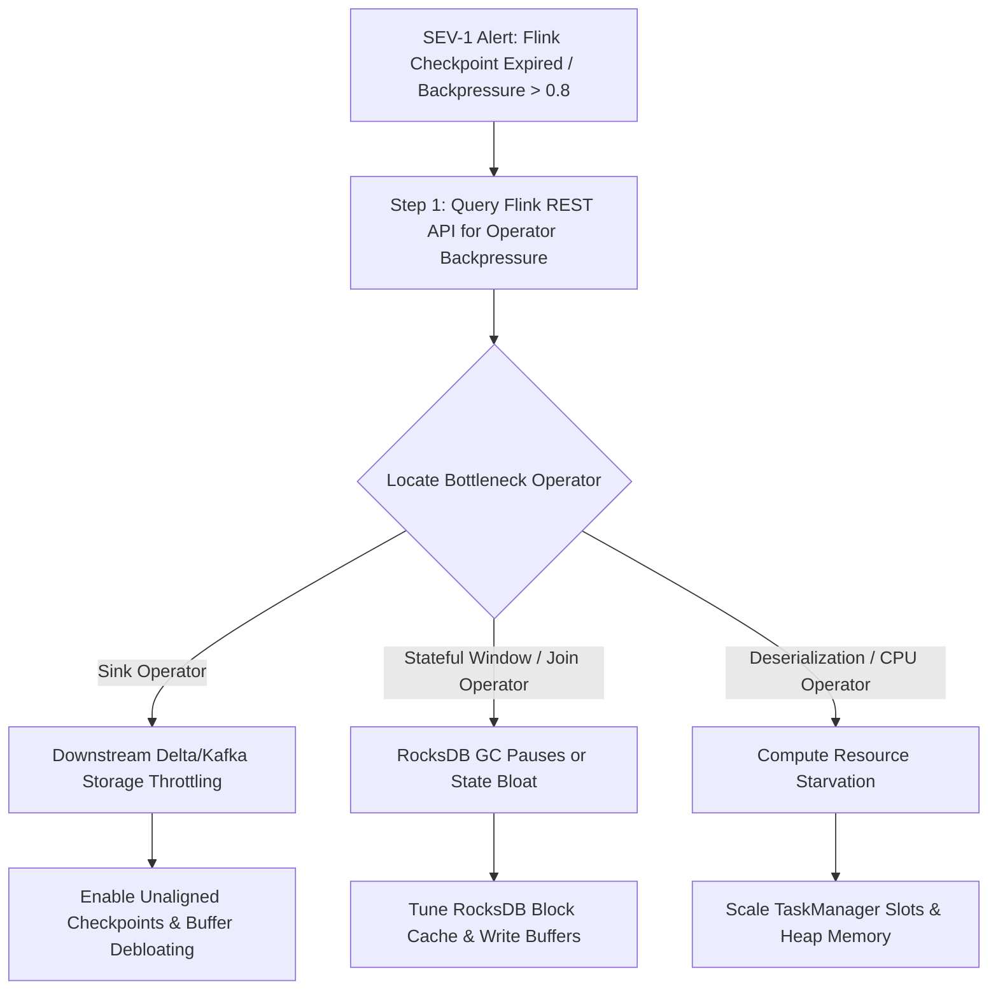

# 🚨 Production Runbook 02: Flink Backpressure & Checkpoint Timeout Triage

> **Incident Severity**: `SEV-1`  
> **Domain**: Apache Flink Stream Processing  
> **Target Systems**: Flink JobManager, TaskManagers, RocksDB StateBackend, ADLS/S3 Checkpoint Storage  
> **Objective**: Eliminate downstream backpressure bottlenecks and resolve failing Flink checkpoints before state corruption.

---

## 1. Emergency Decision Tree



---

## 2. Immediate Diagnostic Procedures (First 5 Minutes)

### Step 1: Query Flink REST API for Operator Backpressure Ratio
```bash
# Query JobManager for job topology and backpressure levels
JOB_ID=$(curl -s http://flink-jobmanager:8081/jobs | jq -r '.jobs[] | select(.status=="RUNNING") | .id')

# Inspect vertex backpressure
curl -s "http://flink-jobmanager:8081/jobs/${JOB_ID}/vertices" | jq -r '.vertices[] | "\(.name): backpressure-level=\(.backpressure-level)"'
```

### Step 2: Check Checkpoint Duration & Expired Counts
```bash
# Inspect checkpoint history and failure reasons
curl -s "http://flink-jobmanager:8081/jobs/${JOB_ID}/checkpoints" | jq '.latest.failed'
```

---

## 3. Root Cause Analysis & Production Remediation

### Primary Root Cause
1. **Aligned Checkpoint Barrier Delay**: High backpressure prevents checkpoint barrier tokens from flowing through operators, leading to `CheckpointExpiredException` after `execution.checkpointing.timeout` (typically 10 minutes).
2. **RocksDB Compaction Spikes**: High cardinality state keys cause RocksDB SST file compaction storms on TaskManager local disks.

### Production Remediation & Configuration Tuning

#### Phase 1: Enable Flink Unaligned Checkpoints & Buffer Debloating
Add these properties to `flink-conf.yaml` to decouple checkpointing from backpressured network buffers:
```yaml
execution.checkpointing.unaligned.enabled: true
execution.checkpointing.alignment-timeout: 2000ms
taskmanager.network.memory.buffer-debloat.enabled: true
taskmanager.network.memory.buffer-debloat.target: 50ms
state.backend.incremental: true
state.backend.rocksdb.memory.managed: true
state.backend.rocksdb.memory.fixed-per-slot: 512mb
```

#### Phase 2: PyFlink Production Pipeline State Configuration
```python
from pyflink.datastream import StreamExecutionEnvironment, CheckpointingMode
from pyflink.datastream.state_backend import EmbeddedRocksDBStateBackend

env = StreamExecutionEnvironment.get_execution_environment()

# Configure resilient checkpointing
env.enable_checkpointing(30000, CheckpointingMode.EXACTLY_ONCE)
cp_config = env.get_checkpoint_config()
cp_config.set_checkpoint_timeout(600000)
cp_config.set_min_pause_between_checkpoints(10000)
cp_config.set_max_concurrent_checkpoints(1)
cp_config.enable_unaligned_checkpoints()

# Production Incremental RocksDB State Store
state_backend = EmbeddedRocksDBStateBackend(enable_incremental_checkpointing=True)
env.set_state_backend(state_backend)
```

---

## 4. Verification & Prevention
- [ ] Verify `checkpoints/` directory on cloud storage is receiving new valid metadata files.
- [ ] Confirm Flink Web UI backpressure metric drops from `HIGH` (red) to `OK` (green).
- [ ] Monitor Prometheus metric `flink_taskmanager_job_task_operator_backPressuredTimeMsPerSecond`.
