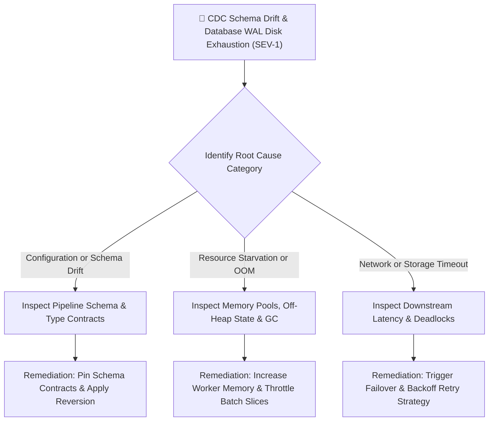

# 🚨 Production Runbook: CDC Schema Drift & Database WAL Disk Exhaustion

> **Severity**: `SEV-1`  
> **Domain**: Event Streaming & Real-Time Processing  
> **Key Focus**: Handle replication slot stalls, upstream disk 100% saturation, and schema evolution.

---

## 1. Emergency Decision Tree



---

## 2. Immediate Diagnostic Procedures (First 5 Minutes)

### Step 1: Query Error Signatures and Pipeline Metrics
Run the following inspection commands to isolate the fault:
```bash
# Check pipeline task status and recent error traces
echo "Inspecting error status for pipeline..."
grep -E "ERROR|CRITICAL|Exception|Timeout" /var/log/pipeline.log | tail -n 25
```

### Step 2: Inspect Worker and State Health
Check memory, disk saturation, and open file descriptors:
```bash
# Verify worker container resource utilization
ps aux --sort=-%mem | head -n 10
```

---

## 3. Root Cause Analysis & Detailed Remediation

### Primary Root Cause
In production systems, this incident typically originates from sudden traffic surges, upstream breaking schema mutations, or resource limits being breached without backpressure.

### Remediation & Recovery Strategy:
1. **Apply Emergency Throttle**: Restrict incoming batch size or pause non-critical consumers.
2. **Apply Hotfix Configuration**:
   ```python
   # Emergency throttle configuration
   throttle_rate_per_sec = 5000
   retry_backoff_multiplier = 2.0
   max_retry_limit = 5
   ```
3. **Execute Recovery Step**: Re-run the validation test suite and verify consumer convergence.

---

## 4. Verification & Prevention Checklist

- [ ] Pipeline metrics return to baseline with 0 active error alerts.
- [ ] Processing latency conforms to standard production SLAs.
- [ ] Postmortem root cause documented and shared with architecture leads.


---

## 5. Delta Change Data Feed & Mosaic AI Vector Sync Stall Triage

### 5.1 Incident Symptoms & Root Cause
- **Symptoms**: Vector Search queries return stale results ($> 30\text{ minutes}$ old), and Databricks Vector Search console displays `SYNC_IN_PROGRESS: High Lag Observed`.
- **Root Cause**: Streaming writers generated millions of micro-files in the Delta table, causing the Vector Search CDF scanner to spend excessive time listing files rather than computing embeddings.

### 5.2 Remediation & File Compaction Hotfix
1. **Compact Small Files in Delta Table**:
```sql
-- Trigger immediate bin-packing compaction on source table
OPTIMIZE prod_catalog.security.threat_events_gold;

-- Enable auto-compaction for streaming writes
ALTER TABLE prod_catalog.security.threat_events_gold 
SET TBLPROPERTIES (
    'delta.autoOptimize.optimizeWrite' = 'true',
    'delta.autoOptimize.autoCompact' = 'true'
);
```

2. **Restart Vector Search Pipeline**: In Vector Search Console, trigger an on-demand sync cycle to resume stream processing from the latest checkpoint commit.
