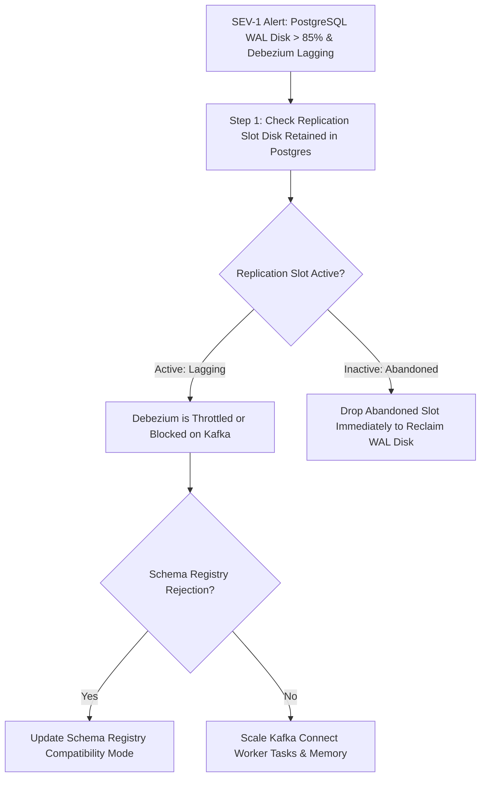

# 🚨 Production Runbook 03: CDC Schema Drift & WAL Disk Exhaustion

> **Incident Severity**: `SEV-1`  
> **Domain**: Change Data Capture (Debezium) & Database Replication  
> **Target Systems**: PostgreSQL Primary, Debezium Connect Cluster, Kafka Connect, Schema Registry  
> **Objective**: Drain PostgreSQL WAL bloat before disk fills to 100%, realign Debezium schema history, and restore replication.

---

## 1. Emergency Decision Tree



---

## 2. Immediate Diagnostic Procedures (First 5 Minutes)

### Step 1: Query PostgreSQL for Replication Slot WAL Lag
```sql
SELECT
    slot_name,
    plugin,
    active,
    pg_size_pretty(pg_wal_lsn_diff(pg_current_wal_lsn(), restart_lsn)) AS wal_backlog_size,
    pg_size_pretty(pg_wal_lsn_diff(pg_current_wal_lsn(), confirmed_flush_lsn)) AS unconfirmed_wal_size
FROM pg_replication_slots
ORDER BY pg_wal_lsn_diff(pg_current_wal_lsn(), restart_lsn) DESC;
```

### Step 2: Check Debezium Connector Task Error Status
```bash
curl -s "http://kafka-connect:8083/connectors/debezium-postgres-orders/status" | jq '.tasks[] | {id: .id, state: .state, trace: .trace}'
```

---

## 3. Root Cause Analysis & Production Remediation

### Primary Root Cause
1. **Schema Evolution Deserialization Error**: An upstream `ALTER TABLE` added an unsupported type or broke backwards compatibility in Confluent Schema Registry. Debezium threw an exception and paused WAL consumption.
2. **WAL Disk Exhaustion**: Because the replication slot remained unconfirmed, PostgreSQL retained all WAL segments until disk usage approached 100%, threatening a full database crash.

### Production Remediation & Configuration Tuning

#### Phase 1: Set Schema Registry Compatibility & Safe Schema Evolution
```bash
# Update Schema Registry compatibility to BACKWARD or FULL_TRANSITIVE
curl -X PUT -H "Content-Type: application/json"   --data '{"compatibility": "BACKWARD"}'   "http://schema-registry:8081/config/orders_cdc_events-value"
```

#### Phase 2: Production Debezium Connector Configuration
```json
{
  "name": "debezium-postgres-orders",
  "config": {
    "connector.class": "io.debezium.connector.postgresql.PostgresConnector",
    "tasks.max": "1",
    "plugin.name": "pgoutput",
    "database.hostname": "postgres-primary.internal",
    "database.port": "5432",
    "database.user": "debezium_cdc",
    "database.password": "${file:/secrets/db.properties:password}",
    "database.dbname": "production_db",
    "database.server.name": "prod_cdc",
    "table.include.list": "public.orders,public.order_items,public.customers",
    "tombstones.on.delete": "true",
    "decimal.handling.mode": "double",
    "schema.history.internal.kafka.bootstrap.servers": "kafka:9092",
    "schema.history.internal.kafka.topic": "schema-history.orders",
    "max.queue.size": "8192",
    "max.batch.size": "2048",
    "poll.interval.ms": "500"
  }
}
```

#### Phase 3: Emergency Slot Cleanup (If WAL Disk > 95%)
```sql
-- DANGER: Drops replication slot and forces full resync, but prevents database outage
-- SELECT pg_drop_replication_slot('debezium_orders_slot');
```

---

## 4. Verification & Prevention
- [ ] Verify `pg_replication_slots` shows `wal_backlog_size < 1 GB`.
- [ ] Confirm Kafka Connect task returns `state: RUNNING`.
- [ ] Configure `max_slot_wal_keep_size = 50GB` in `postgresql.conf` to prevent disk saturation.
