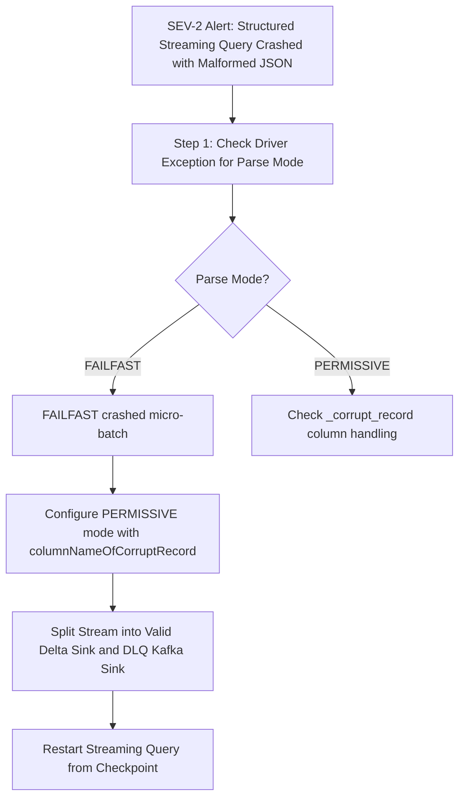

# 🚨 Production Runbook 04: Corrupt Event Deserialization & Dead-Letter Queue (DLQ) Routing

> **Incident Severity**: `SEV-2`  
> **Domain**: Event Streaming & Real-Time Processing  
> **Target Systems**: Spark Structured Streaming, Kafka Brokers, Delta Lake Lakehouse  
> **Objective**: Isolate poison pill payloads, prevent streaming query crashes, and route unparseable events into a transactional DLQ.

---

## 1. Emergency Decision Tree



---

## 2. Immediate Diagnostic Procedures (First 5 Minutes)

### Step 1: Query Spark Driver Error Logs for Corrupt Record Signatures
```bash
# Search for Jackson parsing exception or schema mismatch
grep -E "SparkException|JsonParseException|Malformed records are detected in record parsing" /var/log/spark/driver.log | tail -n 25
```

### Step 2: Inspect Incoming Raw Kafka Payloads
```bash
# Read the latest 5 raw messages to inspect payload deformation
kcat -b "$KAFKA_BOOTSTRAP_SERVERS" -C -t "events.raw" -o -5 -e
```

---

## 3. Root Cause Analysis & Production Remediation

### Primary Root Cause
By default, standard JSON deserialization in Spark Structured Streaming operates under `FAILFAST` mode. When an upstream producer emits malformed JSON (e.g. truncated buffer, missing quotes, non-UTF8 binary characters), the entire streaming micro-batch fails, halting the pipeline.

### Production Remediation: Resilient PySpark DLQ Pattern

```python
from pyspark.sql import SparkSession
from pyspark.sql.functions import col, from_json, current_timestamp, to_json, struct
from pyspark.sql.types import StructType, StructField, StringType, DoubleType, LongType

spark = SparkSession.builder \
    .appName("ProductionResilientStreamingWithDLQ") \
    .getOrCreate()

# 1. Define explicit payload schema with corrupt record capture column
PAYLOAD_SCHEMA = StructType([
    StructField("transaction_id", StringType(), False),
    StructField("customer_id", StringType(), True),
    StructField("amount", DoubleType(), True),
    StructField("timestamp", LongType(), True),
    StructField("_corrupt_record", StringType(), True)  # Captures unparseable bytes
])

# 2. Ingest raw Kafka stream
raw_stream = spark.readStream \
    .format("kafka") \
    .option("kafka.bootstrap.servers", "kafka-1:9092,kafka-2:9092") \
    .option("subscribe", "events.raw") \
    .option("startingOffsets", "latest") \
    .load()

# 3. Parse JSON with PERMISSIVE mode
parsed_stream = raw_stream.select(
    col("key").cast("string").alias("kafka_key"),
    col("value").cast("string").alias("raw_payload"),
    col("topic").alias("source_topic"),
    col("partition").alias("source_partition"),
    col("offset").alias("source_offset"),
    col("timestamp").alias("kafka_timestamp"),
    from_json(col("value").cast("string"), PAYLOAD_SCHEMA, {"mode": "PERMISSIVE", "columnNameOfCorruptRecord": "_corrupt_record"}).alias("data")
)

# 4. Route valid vs corrupt records via foreachBatch sink
def process_micro_batch(batch_df, batch_id):
    batch_df.cache()

    # Valid records: _corrupt_record is NULL and transaction_id is populated
    valid_df = batch_df.filter(col("data._corrupt_record").isNull() & col("data.transaction_id").isNotNull()) \
        .select("kafka_key", "data.*", "kafka_timestamp")

    # Poison pill corrupt records: _corrupt_record is NOT NULL
    corrupt_df = batch_df.filter(col("data._corrupt_record").isNotNull()) \
        .select(
            col("kafka_key").alias("key"),
            to_json(struct(
                col("source_topic"),
                col("source_partition"),
                col("source_offset"),
                col("raw_payload"),
                col("data._corrupt_record").alias("error_details"),
                current_timestamp().alias("quarantine_timestamp")
            )).alias("value")
        )

    # Write valid records to Delta Lake Silver table
    valid_df.write \
        .format("delta") \
        .mode("append") \
        .saveAsTable("lakehouse.silver_transactions")

    # Write corrupt records to Dead-Letter Queue topic
    if corrupt_df.count() > 0:
        corrupt_df.write \
            .format("kafka") \
            .option("kafka.bootstrap.servers", "kafka-1:9092,kafka-2:9092") \
            .option("topic", "events.dlq") \
            .save()

    batch_df.unpersist()

# 5. Start streaming query
query = parsed_stream.writeStream \
    .foreachBatch(process_micro_batch) \
    .option("checkpointLocation", "abfss://checkpoints@datalake.dfs.core.windows.net/transactions_dlq_pipeline") \
    .start()

query.awaitTermination()
```

---

## 4. Verification & Prevention
- [ ] Verify streaming query progresses through batches without crashing.
- [ ] Confirm bad records appear in `events.dlq` topic with diagnostic metadata.
- [ ] Configure Datadog / Prometheus alert on DLQ topic record production rate.
