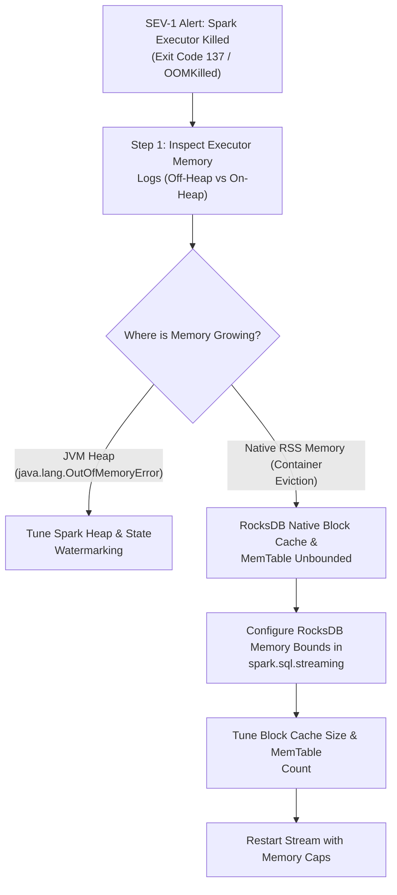

# 🚨 Production Runbook 05: RocksDB State Store Off-Heap Memory Leak Triage

> **Incident Severity**: `SEV-1`  
> **Domain**: Spark Structured Streaming & Stateful Processing  
> **Target Systems**: Spark Driver & Executors (Databricks / Kubernetes), RocksDB Native Engine  
> **Objective**: Diagnose native C++ memory leaks in RocksDB state store, prevent Executor OOM (Exit code 137), and tune memory bounds.

---

## 1. Emergency Decision Tree



---

## 2. Immediate Diagnostic Procedures (First 5 Minutes)

### Step 1: Check Kubernetes / YARN Container Kill Signal
```bash
# Check if container died due to Linux OOM killer (exit code 137)
kubectl describe pod <spark-executor-pod> | grep -E "OOMKilled|Exit Code"
```

### Step 2: Inspect Native Memory Resident Set Size (RSS)
```bash
# Verify Executor memory consumption vs request limits
kubectl top pod <spark-executor-pod>
```

---

## 3. Root Cause Analysis & Production Remediation

### Primary Root Cause
When using `RocksDBStateStoreProvider`, memory is split between JVM On-Heap and native off-heap C++ memory. If the RocksDB block cache and write buffers (memtables) are left unbounded across hundreds of state partitions, native memory allocations exceed the Kubernetes pod memory limit, triggering the OS OOM Killer (`SIGKILL` 137).

### Production Remediation & Configuration Tuning

#### Phase 1: Enforce Strict RocksDB Memory Bounds
Set these Spark configurations to cap native off-heap memory per executor:
```properties
# Cap RocksDB block cache across all state store instances
spark.sql.streaming.stateStore.providerClass=org.apache.spark.sql.execution.streaming.state.RocksDBStateStoreProvider
spark.sql.streaming.stateStore.rocksdb.blockCacheSizeMB=128
spark.sql.streaming.stateStore.rocksdb.lockAcquireTimeoutMs=60000
spark.sql.streaming.stateStore.rocksdb.writeBufferSizeMB=32
spark.sql.streaming.stateStore.rocksdb.maxWriteBufferNumber=3
spark.sql.streaming.stateStore.rocksdb.compactOnCommit=false

# Allocate container memory overhead for native RocksDB allocations (30-40% of heap)
spark.executor.memory=8g
spark.executor.memoryOverhead=4g
```

#### Phase 2: Watermark State Eviction Verification
Ensure streaming state is actively evicted rather than growing indefinitely:
```python
# Event-time watermarking forces state eviction in stateful joins & aggregations
stream_df = raw_df     .withWatermark("event_time", "2 hours")     .groupBy(
        window("event_time", "1 hour", "15 minutes"),
        col("merchant_id")
    ).agg(
        count("transaction_id").alias("tx_count"),
        sum("amount").alias("total_volume")
    )
```

---

## 4. Verification & Prevention
- [ ] Verify Executor pod RSS memory stabilizes below container limit.
- [ ] Confirm Spark UI Structured Streaming tab shows steady `memoryUsedBytes` metric.
- [ ] Set alert on `container_memory_working_set_bytes / container_spec_memory_limit_bytes > 0.85`.
