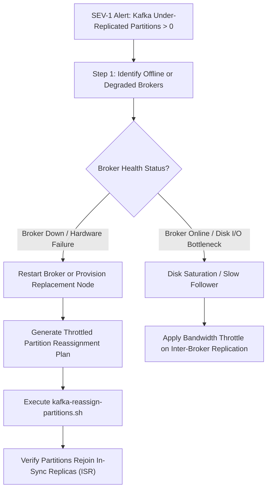

# 🚨 Production Runbook 06: Kafka Under-Replicated Partitions (URP) Disaster Recovery

> **Incident Severity**: `SEV-1`  
> **Domain**: Apache Kafka Cluster Infrastructure  
> **Target Systems**: Kafka Brokers (KRaft / ZooKeeper), OS Disk Subsystems, Network Fabric  
> **Objective**: Recover degraded brokers, rebalance under-replicated partitions safely without saturating inter-broker network bandwidth.

---

## 1. Emergency Decision Tree



---

## 2. Immediate Diagnostic Procedures (First 5 Minutes)

### Step 1: Identify Under-Replicated Partitions and Degraded Topics
```bash
# Query cluster for all topics with under-replicated partitions
kafka-topics.sh --bootstrap-server "$KAFKA_BOOTSTRAP_SERVERS"   --describe --under-replicated-partitions
```

### Step 2: Check Broker Disk Utilization and I/O Wait
```bash
# Inspect disk space across data log directories on all brokers
ansible kafka_brokers -m shell -a "df -h /var/lib/kafka/data"
```

---

## 3. Root Cause Analysis & Production Remediation

### Primary Root Cause
Partitions become under-replicated when follower replicas fall behind the leader's High Watermark (HW) due to broker hardware failure, disk I/O saturation, or network packet drop. If unthrottled reassignment is triggered, massive replica fetch traffic saturates broker network links, causing healthy partitions to fail.

### Production Remediation: Safe Throttled Reassignment

#### Step 1: Create Topics JSON for Reassignment Plan
```json
{
  "topics": [
    {"topic": "transactions.core.v1"},
    {"topic": "user.events.v1"}
  ],
  "version": 1
}
```

#### Step 2: Generate and Execute Throttled Reassignment
```bash
# 1. Generate reassignment plan across surviving brokers (e.g. brokers 1, 2, 3)
kafka-reassign-partitions.sh --bootstrap-server "$KAFKA_BOOTSTRAP_SERVERS"   --topics-to-move-json-file topics.json   --broker-list "1,2,3"   --generate > reassignment.json

# 2. Execute plan with strict bandwidth throttle (50 MB/s = 50000000 bytes/sec)
kafka-reassign-partitions.sh --bootstrap-server "$KAFKA_BOOTSTRAP_SERVERS"   --reassignment-json-file reassignment.json   --execute   --throttle 50000000

# 3. Monitor reassignment progress until completed
kafka-reassign-partitions.sh --bootstrap-server "$KAFKA_BOOTSTRAP_SERVERS"   --reassignment-json-file reassignment.json   --verify

# 4. CRITICAL: Remove bandwidth throttle once reassignment finishes
kafka-reassign-partitions.sh --bootstrap-server "$KAFKA_BOOTSTRAP_SERVERS"   --reassignment-json-file reassignment.json   --verify
```

---

## 4. Verification & Prevention
- [ ] Confirm `kafka-topics.sh --describe --under-replicated-partitions` returns zero output.
- [ ] Verify Prometheus metric `kafka_server_replicamanager_underreplicatedpartitions == 0`.
- [ ] Set `min.insync.replicas=2` and `replication.factor=3` on all mission-critical topics.
